# Advanced Systems & Embedded Engineering: Architecture, Concurrency, and Operating Systems Internals

> **A Comprehensive Textbook Treatise on Systems & Embedded Engineering**  
> *Target Readers*: Systems software engineers, embedded firmware architects, operating systems kernel developers, and hardware-software interface engineers exploring computer systems principles and kernel mechanics.  
> *Core Curriculum*: The C Memory Model, Hardware Register Interfacing, Lock-Free Data Structures, Process & Thread Execution Models, UNIX IPC Primitives, Multiprocessor Synchronization & Memory Ordering, CPU Microarchitecture & Cache Hierarchies, Virtual Memory & Multi-Level Page Tables, MMIO, and PCIe / DMA Hardware Drivers.

---

## Table of Contents
1. [Chapter 1: The C Memory Model, Pointers & Indirection](#chapter-1-the-c-memory-model-pointers--indirection)
   - 1.1 [The Runtime Stack Frame & Pass-by-Value Semantics](#11-the-runtime-stack-frame--pass-by-value-semantics)
   - 1.2 [Multi-Level Indirection: Double Pointers (`T **`) & Dynamic Allocation](#12-multi-level-indirection-double-pointers-t---dynamic-allocation)
   - 1.3 [Pointer-to-Pointer List Manipulation: The Linus Torvalds Idiom](#13-pointer-to-pointer-list-manipulation-the-linus-torvalds-idiom)
   - 1.4 [String Tokenization & Reentrant State Machines](#14-string-tokenization--reentrant-state-machines)
   - 1.5 [Memory Safety, Off-by-One Boundaries & Buffer Overflow Dynamics](#15-memory-safety-off-by-one-boundaries--buffer-overflow-dynamics)
2. [Chapter 2: Hardware Register Interfacing, Bit Manipulation & Struct Layout](#chapter-2-hardware-register-interfacing-bit-manipulation--struct-layout)
   - 2.1 [Low-Level Bit Twiddling: Primitives, Masks & Two's-Complement Properties](#21-low-level-bit-twiddling-primitives-masks--twos-complement-properties)
   - 2.2 [Memory Alignment, Compiler Padding & ABI Packing Constraints](#22-memory-alignment-compiler-padding--abi-packing-constraints)
   - 2.3 [Hardware Register Unions & Struct Overlays](#23-hardware-register-unions--struct-overlays)
   - 2.4 [The `volatile` Qualifier: Architectural Truths vs Compiler Optimizations](#24-the-volatile-qualifier-architectural-truths-vs-compiler-optimizations)
   - 2.5 [Endianness: Network Byte Order, Host Order & Bitfield Portability](#25-endianness-network-byte-order-host-order--bitfield-portability)
3. [Chapter 3: Ring Buffers, Queue Concurrency & Cache Line Optimization](#chapter-3-ring-buffers-queue-concurrency--cache-line-optimization)
   - 3.1 [The Geometry of Circular Buffers: The Modulo Bottleneck](#31-the-geometry-of-circular-buffers-the-modulo-bottleneck)
   - 3.2 [Power-of-Two Bitmask Indexing & Linux Kernel `kfifo` Architecture](#32-power-of-two-bitmask-indexing--linux-kernel-kfifo-architecture)
   - 3.3 [Lock-Free Single-Producer Single-Consumer (SPSC) Synchronization](#33-lock-free-single-producer-single-consumer-spsc-synchronization)
   - 3.4 [Cache Line Structure, Memory Bus Invalidation & False Sharing](#34-cache-line-structure-memory-bus-invalidation--false-sharing)
4. [Chapter 4: Process Architecture, Context Switching & Kernel Signals](#chapter-4-process-architecture-context-switching--kernel-signals)
   - 4.1 [Process Isolation: The Virtual Memory Boundary & Address Space Layout](#41-process-isolation-the-virtual-memory-boundary--address-space-layout)
   - 4.2 [The Anatomy of `fork()`: Copy-on-Write (COW) Mechanics](#42-the-anatomy-of-fork-copy-on-write-cow-mechanics)
   - 4.3 [Context Switch Anatomy: Process vs Thread Transitions](#43-context-switch-anatomy-process-vs-thread-transitions)
   - 4.4 [Thread-Local Storage (TLS) Architecture: GS/FS & TPIDR Registers](#44-thread-local-storage-tls-architecture-gsfs--tpidr-registers)
   - 4.5 [Process Lifecycle: Exit States, Zombies & Non-Blocking Reaping](#45-process-lifecycle-exit-states-zombies--non-blocking-reaping)
   - 4.6 [UNIX Signal Semantics: Reentrancy, Interrupted Syscalls (`EINTR`) & Watchdogs](#46-unix-signal-semantics-reentrancy-interrupted-syscalls-eintr--watchdogs)
   - 4.7 [File Descriptor Duplication & I/O Redirection (`dup2`)](#47-file-descriptor-duplication--io-redirection-dup2)
5. [Chapter 5: UNIX Pipes & Kernel Stream IPC](#chapter-5-unix-pipes--kernel-stream-ipc)
   - 5.1 [Kernel Implementation of Pipes: The Circular Buffer Inode](#51-kernel-implementation-of-pipes-the-circular-buffer-inode)
   - 5.2 [Reference-Counted Endpoints & The Phantom Writer Deadlock](#52-reference-counted-endpoints--the-phantom-writer-deadlock)
   - 5.3 [Broken Pipes: `SIGPIPE` Delivery, `EPIPE` & Network Socket Parallels](#53-broken-pipes-sigpipe-delivery-epipe--network-socket-parallels)
   - 5.4 [Atomicity Guarantees: `PIPE_BUF` & Interleaved Data Streams](#54-atomicity-guarantees-pipe_buf--interleaved-data-streams)
   - 5.5 [Bidirectional IPC & Multi-Process Communication Topologies](#55-bidirectional-ipc--multi-process-communication-topologies)
6. [Chapter 6: Concurrency, Thread Synchronization & Memory Consistency Models](#chapter-6-concurrency-thread-synchronization--memory-consistency-models)
   - 6.1 [Condition Variables: Hoare vs Mesa Semantics & The Spurious Wakeup Invariant](#61-condition-variables-hoare-vs-mesa-semantics--the-spurious-wakeup-invariant)
   - 6.2 [Mutual Exclusion vs Counting Semaphores: Ownership & ISR Safety](#62-mutual-exclusion-vs-counting-semaphores-ownership--isr-safety)
   - 6.3 [Real-Time Scheduling Hazards: Priority Inversion & The Mars Pathfinder Case](#63-real-time-scheduling-hazards-priority-inversion--the-mars-pathfinder-case)
   - 6.4 [Reader-Writer Synchronization: Writer Starvation & Writer-Preference RWLocks](#64-reader-writer-synchronization-writer-starvation--writer-preference-rwlocks)
   - 6.5 [Deadlock Theory: Coffman Conditions & Dijkstra's Total Resource Ordering](#65-deadlock-theory-coffman-conditions--dijkstras-total-resource-ordering)
   - 6.6 [The Hardware Memory Model: C11 `stdatomic` & Acquire-Release Consistency](#66-the-hardware-memory-model-c11-stdatomic--acquire-release-consistency)
   - 6.7 [Multiprocessor Cache Coherence: The MESI Protocol & TTAS Spinlocks](#67-multiprocessor-cache-coherence-the-mesi-protocol--ttas-spinlocks)
7. [Chapter 7: Memory Hierarchy, CPU Caches & Hardware Performance](#chapter-7-memory-hierarchy-cpu-caches--hardware-performance)
   - 7.1 [The Von Neumann Memory Wall: Latency Pyramid across Microarchitectures](#71-the-von-neumann-memory-wall-latency-pyramid-across-microarchitectures)
   - 7.2 [Cache Line Anatomy: Tags, Sets & Offset Mapping](#72-cache-line-anatomy-tags-sets--offset-mapping)
   - 7.3 [The 4 C's of Cache Misses: Compulsory, Capacity, Conflict & Coherence](#73-the-4-cs-of-cache-misses-compulsory-capacity-conflict--coherence)
   - 7.4 [Spatial and Temporal Locality: Row-Major vs Column-Major Access & Pointer Chasing](#74-spatial-and-temporal-locality-row-major-vs-column-major-access--pointer-chasing)
   - 7.5 [Memory Alignment Penalties: Split-Line Access & Hardware Alignment Faults](#75-memory-alignment-penalties-split-line-access--hardware-alignment-faults)
   - 7.6 [Elimination of False Sharing: Microarchitectural Analysis & `alignas(64)`](#76-elimination-of-false-sharing-microarchitectural-analysis--alignas64)
8. [Chapter 8: Virtual Memory, Multi-Level Page Tables & The MMU](#chapter-8-virtual-memory-multi-level-page-tables--the-mmu)
   - 8.1 [The Virtual-to-Physical Address Translation Abstraction](#81-the-virtual-to-physical-address-translation-abstraction)
   - 8.2 [Multi-Level Paging Architecture: Sparse Radix Trees (x86_64 & ARMv8)](#82-multi-level-paging-architecture-sparse-radix-trees-x86_64--armv8)
   - 8.3 [Hardware Page Table Entry (PTE) Architecture & Bitflags](#83-hardware-page-table-entry-pte-architecture--bitflags)
   - 8.4 [Huge Pages (2MB & 1GB): TLB Reach Optimization & Footprint Reduction](#84-huge-pages-2mb--1gb-tlb-reach-optimization--footprint-reduction)
   - 8.5 [The Translation Lookaside Buffer (TLB): Misses, Shootdowns & PCID/ASID Tagging](#85-the-translation-lookaside-buffer-tlb-misses-shootdowns--pcidasid-tagging)
   - 8.6 [Page Fault Taxonomy: Minor (Soft), Major (Hard) & Invalid (SIGSEGV) Faults](#86-page-fault-taxonomy-minor-soft-major-hard--invalid-sigsegv-faults)
9. [Chapter 9: Hardware Bus Protocols, MMIO & Device Drivers](#chapter-9-hardware-bus-protocols-mmio--device-drivers)
   - 9.1 [Memory-Mapped I/O (MMIO): Device Registers, Memory Barriers & Side Effects](#91-memory-mapped-io-mmio-device-registers-memory-barriers--side-effects)
   - 9.2 [The PCI Express (PCIe) Architecture: Configuration Space & The BAR Probing Handshake](#92-the-pci-express-pcie-architecture-configuration-space--the-bar-probing-handshake)
   - 9.3 [Direct Memory Access (DMA): Coherent vs Streaming & Circular Descriptor Rings](#93-direct-memory-access-dma-coherent-vs-streaming--circular-descriptor-rings)
   - 9.4 [Interrupt Architecture: Top-Half HardIRQ vs Bottom-Half Workqueues](#94-interrupt-architecture-top-half-hardirq-vs-bottom-half-workqueues)
10. [Appendix: Core Systems Engineering Synthesis & Architecture Invariants](#appendix-core-systems-engineering-synthesis--architecture-invariants)

---

## Chapter 1: The C Memory Model, Pointers & Indirection

### 1.1 The Runtime Stack Frame & Pass-by-Value Semantics
At the core of the C programming language is a fundamental architectural rule: **every argument in C is passed strictly by value**. When a function call instruction (`call` on x86_64, `bl` on ARM) executes, the runtime environment establishes a stack frame. Arguments are pushed onto the stack or passed via designated architecture ABI registers (e.g., `RDI`, `RSI`, `RDX`, `RCX`, `R8`, `R9` in the System V AMD64 ABI; `X0`-`X7` in AAPCS64).

Inside the callee, parameters are local variables initialized with copies of the caller's arguments. Mutating a parameter inside the callee mutates solely the local copy in the callee's frame. If the caller wishes for the callee to mutate a variable residing in the caller's stack frame or to rebind a pointer to freshly allocated heap memory, the caller must explicitly pass the **memory address** of that variable.

### 1.2 Multi-Level Indirection: Double Pointers (`T **`) & Dynamic Allocation
A common architectural bug in systems software occurs when an engineer attempts to allocate a buffer inside a helper routine by passing a single pointer `uint8_t *ptr`:

```c
/* FLAWED DESIGN: Pass-by-value prevents caller's pointer from mutating */
void allocate_buffer_flawed(uint8_t *out_ptr, size_t size)
{
    out_ptr = (uint8_t *)malloc(size); /* Mutates local copy only! */
}
```

Because `out_ptr` is passed by value, assigning the return of `malloc()` simply overwrites the local copy inside the stack frame of `allocate_buffer_flawed()`. When the function returns, its stack frame is popped, the allocated memory address is lost forever (generating a memory leak), and the caller's pointer remains `NULL` or uninitialized, leading to a catastrophic `NULL` pointer dereference or undefined behavior.

To solve this, the caller must pass the **address of the pointer variable** (`uint8_t **out_ptr`). The callee dereferences this handle once (`*out_ptr = malloc(size);`), mutating the actual value stored in the caller's stack frame.

```c
#include <stdio.h>
#include <stdlib.h>
#include <stdint.h>
#include <stdbool.h>

bool allocate_buffer(uint8_t **out_ptr, size_t size)
{
    if(out_ptr == NULL || size == 0)
    {
        return false;
    }

    *out_ptr = (uint8_t *)malloc(size);
    if(*out_ptr == NULL)
    {
        return false;
    }

    return true;
}
```

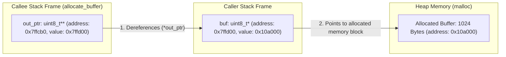

### 1.3 Pointer-to-Pointer List Manipulation: The Linus Torvalds Idiom
In single-linked list operations, removing a targeted node traditionally introduces branching. If the targeted node happens to be the head of the list, `head` itself must be reassigned (`*head = target->next;`). If the targeted node is an interior or tail node, the `next` pointer of the predecessor must be reassigned (`prev->next = target->next;`).

This special-case conditional logic (`if (prev == NULL)`) is an architectural smell. Linus Torvalds famously highlighted that clean systems programming requires recognizing that the head pointer and every `next` pointer in the list are fundamentally the **exact same type of object: a pointer to a node (`Node *`)**.

By maintaining an indirect double-pointer (`Node **indirect`) that points to the pointer referencing the current node, the algorithm eliminates all special cases:

```c
typedef struct Node
{
    int val;
    struct Node *next;
} Node;

void remove_node_linus(Node **indirect, int target)
{
    /* indirect points to the pointer that holds the address of the current node.
     * Initially, indirect points to &head.
     * In subsequent iterations, indirect points to &(current->next). */
    while(*indirect != NULL)
    {
        Node *entry = *indirect;
        if(entry->val == target)
        {
            /* Overwrite the pointer that led to entry with entry->next.
             * If entry was head, *indirect updates head.
             * If entry was interior, *indirect updates prev->next. */
            *indirect = entry->next;
            free(entry);
            return;
        }
        indirect = &(entry->next);
    }
}
```

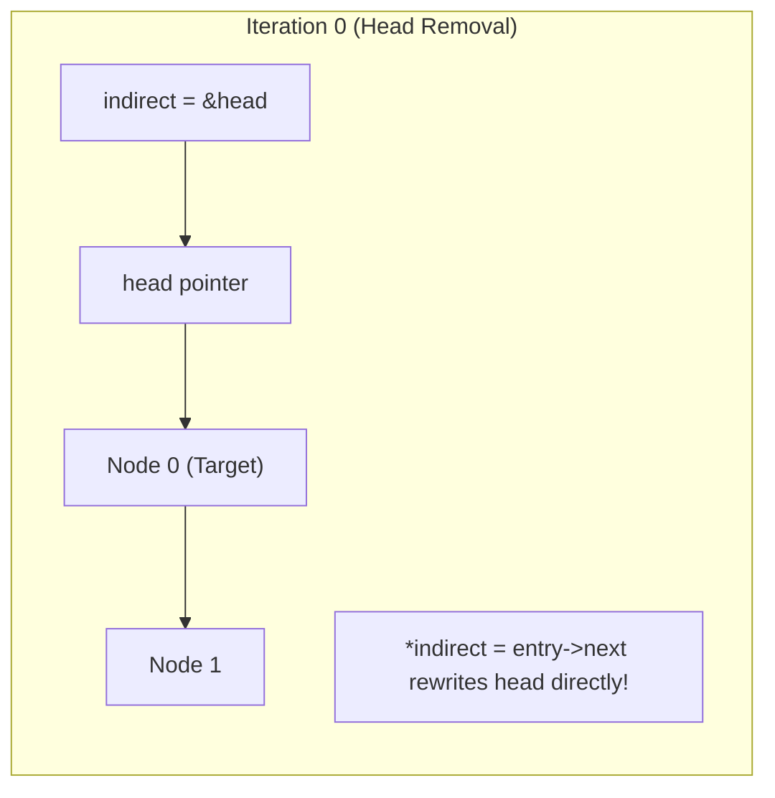

### 1.4 String Tokenization & Reentrant State Machines
Parsing string protocols (e.g., AT commands, HTTP headers, command line inputs) requires tokenization. Traditional POSIX systems provided `strtok()`, which relies on an internal static pointer to retain position between calls:

```c
/* DANGEROUS: strtok() is non-reentrant and inherently thread-unsafe */
char *token = strtok(input_str, " ");
while(token != NULL)
{
    token = strtok(NULL, " ");
}
```

In multi-threaded applications or nested parsing routines (e.g., parsing a comma-separated list of semicolon-separated key-value pairs), `strtok()` silently corrupts the parsing state because all callers share that single static pointer.

Modern robust systems mandate reentrant tokenizers:
1. `strtok_r()` (POSIX): Demands an explicit caller-allocated context pointer (`char **saveptr`).
2. `strsep()` (BSD / Modern Linux): Directly mutates the caller's cursor pointer (`char **stringp`). Unlike `strtok_r()`, `strsep()` correctly handles consecutive delimiters by returning an empty string (`""`), which is critical for parsing RFC 4180 CSV formats.

```c
/* Production-grade streaming cursor tokenizer */
char *next_token(char **cursor, char delim)
{
    if(cursor == NULL || *cursor == NULL || **cursor == '\0')
    {
        return NULL;
    }

    char *start = *cursor;
    char *p = strchr(start, delim);

    if(p != NULL)
    {
        *p = '\0';        /* Terminate token in place */
        *cursor = p + 1;  /* Advance caller cursor past delimiter */
    }
    else
    {
        *cursor = NULL;   /* Reached the final token */
    }

    return start;
}
```

### 1.5 Memory Safety, Off-by-One Boundaries & Buffer Overflow Dynamics
Systems engineers must guard rigorously against off-by-one errors and unchecked copy operations. The table below illustrates the safety guarantees of standard C string APIs:

| Function | Guaranteed Null-Termination? | Return Value Semantics | Microarchitectural / Safety Pitfall |
| :--- | :--- | :--- | :--- |
| `strcpy(dst, src)` | **YES** | `dst` pointer | Unbounded write. Guarantees remote code execution vulnerabilities on untrusted input. |
| `strncpy(dst, src, n)` | **NO** (if `strlen(src) >= n`) | `dst` pointer | If source exceeds `n`, destination is left **unterminated**. If source is short, zero-pads all remaining bytes to `n`, causing cache and CPU stalls. |
| `snprintf(dst, n, fmt)` | **YES** (if $n > 0$) | Bytes that **would have been written** (excluding `\0`) | If return value $\ge n$, truncation occurred. Using return value as write offset without checking causes out-of-bounds writes! |
| `strlcpy(dst, src, n)` | **YES** (if $n > 0$) | Total length of `src` string | BSD-standard; cleanly truncates and guarantees null-termination. Non-standard on glibc without `libbsd`. |

```c
/* Canonical defensive copy pattern */
bool safe_string_copy(char *dst, size_t dst_capacity, const char *src)
{
    if(dst == NULL || dst_capacity == 0)
    {
        return false;
    }

    int written = snprintf(dst, dst_capacity, "%s", src ? src : "");
    if(written < 0 || (size_t)written >= dst_capacity)
    {
        /* Truncation occurred: defensive recovery */
        dst[dst_capacity - 1] = '\0';
        return false;
    }

    return true;
}
```

---

## Chapter 2: Hardware Register Interfacing, Bit Manipulation & Struct Layout

### 2.1 Low-Level Bit Twiddling: Primitives, Masks & Two's-Complement Properties
In systems and firmware engineering, the processor directly coordinates with hardware devices via registers mapped to specific bits. Bitwise manipulation must be second nature:

```c
#define BIT(n)              (1U << (n))
#define SET_BIT(reg, n)     ((reg) |= BIT(n))
#define CLEAR_BIT(reg, n)   ((reg) &= ~BIT(n))
#define TOGGLE_BIT(reg, n)  ((reg) ^= BIT(n))
#define TEST_BIT(reg, n)    (((reg) & BIT(n)) != 0U)

/* Extract arbitrary bitfield [high:low] */
#define EXTRACT_BITS(reg, high, low) \
    (((reg) >> (low)) & ((1U << ((high) - (low) + 1U)) - 1U))
```

#### Two's-Complement Mathematical Invariants:
1. **Isolate Lowest Set Bit**: `lowest = val & (-val);`
   - In two's-complement arithmetic, `-val = ~val + 1`. Inverting `val` flips all bits up to the lowest set bit. Adding 1 cascades the carry back up to the lowest set bit. Performing bitwise AND with original `val` zeros out all bits except the lowest active bit.
2. **Clear Lowest Set Bit (Brian Kernighan's Algorithm)**: `val = val & (val - 1);`
   - Subtracting 1 flips the lowest set bit to 0 and all trailing zeros to 1. Performing bitwise AND with `val` strips off that lowest active bit without looping.
3. **Power-of-Two Validation**: `bool is_pow2 = (val > 0) && ((val & (val - 1)) == 0);`

### 2.2 Memory Alignment, Compiler Padding & ABI Packing Constraints
CPUs do not read memory in individual bytes; they fetch data across memory buses in words (32-bit or 64-bit aligned chunks). To optimize memory bus throughput and avoid split-bus access penalties:
- A $k$-byte primitive type must reside at an address that is a multiple of $k$ (e.g., `uint32_t` on 4-byte boundaries, pointers on 8-byte boundaries).
- The compiler automatically injects **padding bytes** between struct members and at the end of the struct to ensure each member—and arrays of the struct—satisfy alignment rules.

```c
/* Suboptimal layout: 12 bytes on a 32/64-bit ABI */
struct Padded
{
    uint8_t  a;    /* 1 byte + 3 bytes padding */
    uint32_t b;    /* 4 bytes */
    uint8_t  c;    /* 1 byte + 3 bytes trailing padding */
};

/* Reordered by descending size: 8 bytes (33% memory footprint reduction) */
struct Optimized
{
    uint32_t b;    /* 4 bytes */
    uint8_t  a;    /* 1 byte */
    uint8_t  c;    /* 1 byte + 2 bytes trailing padding */
};

/* Packed hardware wire format: 6 bytes (Zero padding) */
struct __attribute__((packed)) WireHeader
{
    uint8_t  a;    /* 1 byte */
    uint32_t b;    /* 4 bytes (unaligned access on strict RISC causes SIGBUS!) */
    uint8_t  c;    /* 1 byte */
};
```

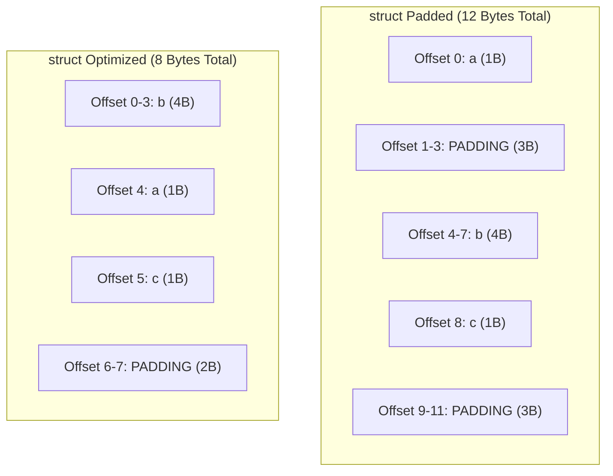

### 2.3 Hardware Register Unions & Struct Overlays
In embedded microcontroller and SoC driver development, control registers frequently expose both word-level write access (for atomic configuration) and bitfield-level accessibility (for clear driver semantics). Combining a `union` with a `struct` provides both capabilities:

```c
typedef union
{
    uint32_t raw;
    struct
    {
        uint32_t enable      : 1;  /* Bit 0: Module Enable */
        uint32_t mode        : 3;  /* Bits [3:1]: Operating Mode */
        uint32_t irq_en      : 1;  /* Bit 4: Interrupt Request Enable */
        uint32_t reserved    : 26; /* Bits [30:5]: Reserved */
        uint32_t busy        : 1;  /* Bit 31: Hardware Busy Flag (Read-Only) */
    } fields;
} HardwareCtrlReg;

/* Usage in driver: */
volatile HardwareCtrlReg *ctrl = (volatile HardwareCtrlReg *)0x40001000UL;

/* Bitfield manipulation: */
ctrl->fields.enable = 1;
ctrl->fields.mode = 0x2;

/* Atomic word-level write: */
ctrl->raw = 0x00000005UL;
```

### 2.4 The `volatile` Qualifier: Architectural Truths vs Compiler Optimizations
Few C keywords are as misunderstood as `volatile`.
- **What `volatile` DOES**: It commands the compiler optimizer: *"Do not cache this variable in a CPU register; do not elide reads or writes to this memory location; and do not reorder accesses to this variable relative to other volatile accesses."* Every read or write must generate an actual memory bus transaction (`ldr` / `str` instruction).
- **What `volatile` DOES NOT DO**:
  1. It **does NOT** make operations atomic (`volatile int count; count++` compiles to a read-modify-write sequence that suffers from race conditions).
  2. It **does NOT** act as a CPU hardware memory barrier (modern out-of-order processors can reorder volatile memory instructions relative to non-volatile memory instructions).
  3. It **does NOT** provide thread synchronization in multi-threaded code.

```c
/* Valid use of volatile: Polling a hardware MMIO status register */
#define UART0_STATUS_REG (*(volatile uint32_t *)0x4000C014UL)
#define UART_TX_READY_BIT (1U << 3)

void uart_transmit_byte(uint8_t byte)
{
    /* Without volatile, compiler hoists read out of loop: while(1); -> infinite loop! */
    while((UART0_STATUS_REG & UART_TX_READY_BIT) == 0)
    {
        /* Busy wait for hardware ready flag */
    }
    *(volatile uint32_t *)0x4000C000UL = byte;
}
```

### 2.5 Endianness: Network Byte Order, Host Order & Bitfield Portability
Endianness defines the byte ordering of multi-byte numbers in physical memory:
- **Little-Endian (x86_64, ARM default)**: Least Significant Byte (LSB) stored at lowest memory address.
- **Big-Endian (Network Byte Order, IBM Power, SPARC)**: Most Significant Byte (MSB) stored at lowest memory address.

```c
/* Architectural Endianness Detection at Runtime */
bool is_little_endian(void)
{
    uint16_t word = 0x0001;
    uint8_t *byte_ptr = (uint8_t *)&word;
    return (*byte_ptr == 0x01);
}
```

> [!WARNING]
> **Bitfield Portability Trap**: The C standard does NOT specify whether bitfields are allocated from LSB to MSB or MSB to LSB within a storage unit. Never use C bitfields for over-the-wire network packet headers or cross-platform hardware register layouts without compiler-specific conditional compilation. Use explicit shift and bitmask operators (`EXTRACT_BITS`) instead.

---

## Chapter 3: Ring Buffers, Queue Concurrency & Cache Line Optimization

### 3.1 The Geometry of Circular Buffers: The Modulo Bottleneck
A circular ring buffer is the canonical data structure for streaming data between asynchronous producers and consumers (e.g., UART RX interrupts, audio DSP pipelines, network packet engines).

A traditional implementation tracks `head` and `tail` modulo capacity:
```c
head = (head + 1) % capacity;
```
On modern microarchitectures, integer division and modulo (`div` / `idiv`) are notoriously expensive hardware instructions, requiring 15–40 CPU cycles. In high-throughput kernel drivers processing millions of packets per second, the modulo operator creates an severe pipeline bottleneck.

### 3.2 Power-of-Two Bitmask Indexing & Linux Kernel `kfifo` Architecture
If buffer capacity is constrained to a **power of two** ($2^N$), the modulo operation simplifies mathematically to a single-cycle bitwise AND:
$$\text{index} \pmod{2^N} \equiv \text{index} \ \& \ (2^N - 1)$$

The Linux kernel `kfifo` architecture takes this optimization a step further by using **free-running 32-bit unsigned integers** for `in` (write) and `out` (read) indices:
- `in` and `out` are continuously incremented without ever wrapping them modulo capacity.
- The actual storage array slot is calculated on demand: `buffer[in & (size - 1)]`.
- Current fill level is always: `in - out`.
- Available space is: `size - (in - out)`.

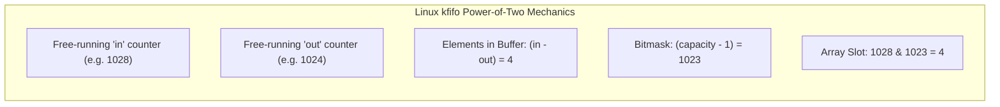

**The Two's-Complement Wrapping Invariant**:
When `in` reaches $2^{32} - 1$ and increments to $0$, does `in - out` break?
**No!** In unsigned C arithmetic, operations are guaranteed to wrap modulo $2^{32}$. For example, if `in = 0` and `out = 0xFFFFFFFE` ($2^{32}-2$), `in - out = 0 - 0xFFFFFFFE = 2`. The arithmetic produces the exact correct fill level without branching.

### 3.3 Lock-Free Single-Producer Single-Consumer (SPSC) Synchronization
When exactly one thread writes to the queue and exactly one thread reads from the queue, mutual exclusion locks can be eliminated entirely using C11 atomic operations:

```c
#include <stdatomic.h>
#include <stdbool.h>
#include <stdint.h>

#define QUEUE_CAPACITY 1024U /* Must be power of 2 */
#define QUEUE_MASK     (QUEUE_CAPACITY - 1U)

typedef struct
{
    uint8_t buffer[QUEUE_CAPACITY];
    _Atomic size_t head; /* Producer writes here */
    _Atomic size_t tail; /* Consumer reads here */
} SpscQueue;

bool spsc_push(SpscQueue *q, uint8_t val)
{
    size_t h = atomic_load_explicit(&q->head, memory_order_relaxed);
    size_t t = atomic_load_explicit(&q->tail, memory_order_acquire);

    /* Queue full condition */
    if((h - t) == QUEUE_CAPACITY)
    {
        return false;
    }

    q->buffer[h & QUEUE_MASK] = val;

    /* Release fence: Ensure data byte is stored in memory BEFORE head index is published */
    atomic_store_explicit(&q->head, h + 1, memory_order_release);
    return true;
}

bool spsc_pop(SpscQueue *q, uint8_t *out_val)
{
    size_t t = atomic_load_explicit(&q->tail, memory_order_relaxed);
    size_t h = atomic_load_explicit(&q->head, memory_order_acquire);

    /* Queue empty condition */
    if(h == t)
    {
        return false;
    }

    *out_val = q->buffer[t & QUEUE_MASK];

    /* Release fence: Ensure data read completes BEFORE updated tail index is published */
    atomic_store_explicit(&q->tail, t + 1, memory_order_release);
    return true;
}
```

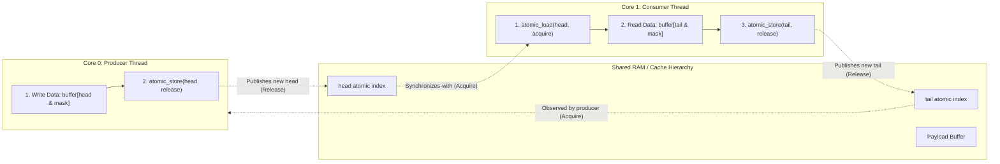

### 3.4 Cache Line Structure, Memory Bus Invalidation & False Sharing
Modern CPUs access main memory in uniform 64-byte chunks known as **Cache Lines**.
If the producer's `head` index and the consumer's `tail` index reside in adjacent memory within the same 64-byte cache line:
1. When Core 0 writes to `head`, the hardware MESI cache coherency protocol marks Core 1's copy of that entire 64-byte cache line as **Invalid (I)**.
2. When Core 1 attempts to read or update `tail`, it experiences a **Cache Miss**, forcing a cache line reload across the interconnect.
3. This continuous ping-ponging of the cache line between cores is called **False Sharing**. It destroys multi-threaded performance, causing lock-free algorithms to run 10x–50x slower than expected.

**The Solution: Cache Line Alignment and Padding**:
```c
#include <stdalign.h>

#define CACHE_LINE_SIZE 64U

typedef struct
{
    /* Producer cache line */
    alignas(CACHE_LINE_SIZE) _Atomic size_t head;
    uint8_t pad1[CACHE_LINE_SIZE - sizeof(_Atomic size_t)];

    /* Consumer cache line */
    alignas(CACHE_LINE_SIZE) _Atomic size_t tail;
    uint8_t pad2[CACHE_LINE_SIZE - sizeof(_Atomic size_t)];

    /* Buffer array */
    alignas(CACHE_LINE_SIZE) uint8_t buffer[QUEUE_CAPACITY];
} OptimizedSpscQueue;
```

---

## Chapter 4: Process Architecture, Context Switching & Kernel Signals

### 4.1 Process Isolation: The Virtual Memory Boundary & Address Space Layout
An operating system process is the fundamental abstraction of execution isolation. The kernel guarantees that each process executes as though it possesses exclusive access to the processor's linear virtual address space (e.g., 48-bit canonical virtual address space on x86_64 and ARMv8).

This isolation is enforced at the hardware level by the processor's **Memory Management Unit (MMU)**. Every process maintains an independent hierarchical page table. The base physical address of the process's page table root is stored in a dedicated CPU control register:
- **x86_64**: `CR3` register.
- **ARMv8-A**: `TTBR0_EL0` (Translation Table Base Register 0, Exception Level 0).

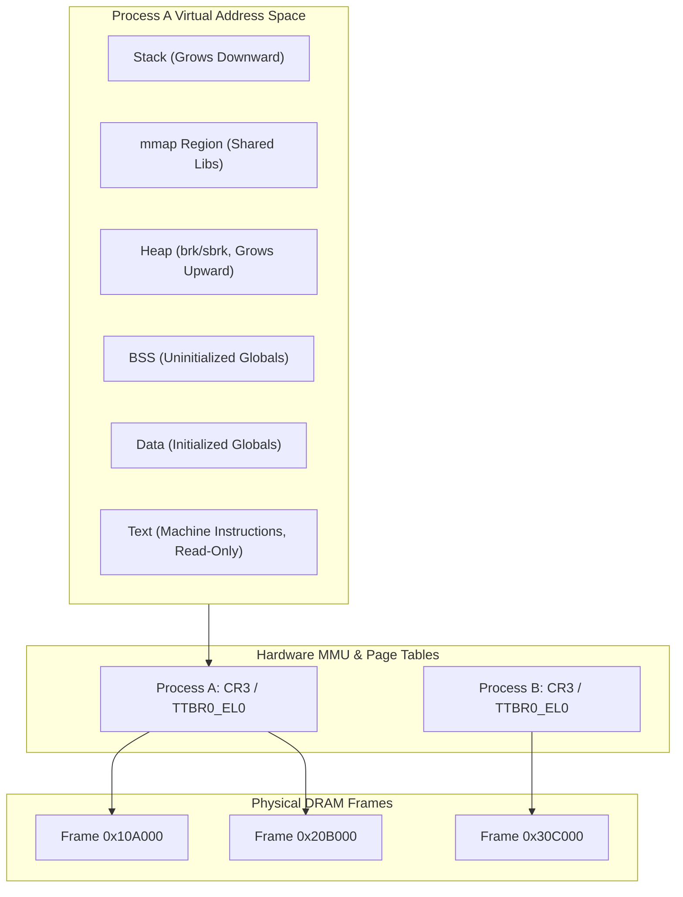

### 4.2 The Anatomy of `fork()`: Copy-on-Write (COW) Mechanics
When a process invokes `fork()`, the kernel creates a child process that is an exact duplicate of the parent. Duplicating tens of gigabytes of physical RAM synchronously during `fork()` would be devastatingly slow.

Instead, modern kernels employ **Copy-on-Write (COW)**:
1. The kernel duplicates the **page tables** of the parent, but does not duplicate the underlying physical memory frames.
2. All writable page table entries (PTEs) in both parent and child are marked **Read-Only** (`R/W = 0`), and the physical frames' reference counts are incremented.
3. If either process attempts to write to a page, the CPU hardware raises a **Page Fault Exception** (`#PF`).
4. The kernel's page fault handler verifies that the address resides in a valid writable Virtual Memory Area (VMA). It allocates a new physical frame, copies the 4KB data, updates the faulting process's PTE with Read/Write permission, and resumes execution.

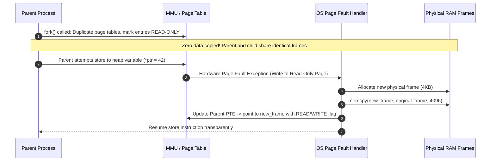

#### File Descriptor Table vs Open File Table:
During `fork()`, the process's **File Descriptor Table** is cloned into the child, but the underlying kernel **Open File Table entries are SHARED**:
- If child writes to standard output, the file offset advances in the shared Open File Table entry, so the parent's next write observes the advanced offset!

### 4.3 Context Switch Anatomy: Process vs Thread Transitions
A context switch is the sequence of operations required to suspend the currently executing task on a CPU core and resume another task.

#### Detailed Low-Level Step-by-Step Anatomy:
1. **Interrupt or System Call Entry**: Transition from User Mode to Kernel Mode (Ring 3 $\to$ Ring 0 on x86; EL0 $\to$ EL1 on ARM). The CPU automatically saves user-space Instruction Pointer (`RIP`/`PC`), Stack Pointer (`RSP`/`SP`), and Flags on the task's kernel stack.
2. **Saving Architecture Registers**: The kernel pushes remaining Callee-Saved General Purpose Registers (`RBX`, `RBP`, `R12`-`R15`) into the task's Process/Thread Control Block (PCB/TCB).
3. **Scheduler Invocation**: The OS scheduler (e.g., Linux Completely Fair Scheduler - CFS) selects the next runnable task.
4. **Memory Context Evaluation**:
   - **Thread Switch (Intra-Process)**: Both threads share the exact same virtual address space. **The MMU root pointer (`CR3` / `TTBR0_EL0`) is NOT modified.** Translation Lookaside Buffer (TLB) entries remain valid.
   - **Process Switch (Inter-Process)**: The target task belongs to a different process. **The MMU root register must be reloaded with the new process's page table base.**
5. **TLB Handling & Modern Hardware Tagging**:
   - *Legacy Architecture*: Reloading `CR3` invalidated all non-global TLB entries, forcing a wave of expensive 4-level memory walks on subsequent instructions.
   - *Modern Architecture*: x86 **PCID (Process Context Identifiers)** and ARM **ASID (Address Space Identifiers)** tag each TLB entry with an address space ID. Processes can switch without flushing the TLB!
6. **Cache Pollution (The Dominant Context Switch Cost)**:
   - The direct cost of swapping CPU registers is negligible (~1–2 microseconds).
   - The indirect cost—**cache pollution**—is severe (10–50 microseconds). The incoming process sweeps through memory, evicting the previous process's working set from L1 instruction, L1 data, and L2 caches.

| Metric | Thread Context Switch | Process Context Switch |
| :--- | :--- | :--- |
| **Virtual Memory Context** | Shared (No MMU register change) | Distinct (`CR3` / `TTBR0_EL0` reloaded) |
| **TLB Invalidation** | Zero flush required | Flush required UNLESS hardware PCID/ASID enabled |
| **L1/L2 Cache Impact** | Minimal (threads often share data/code) | Severe (working set evicted; cache pollution) |
| **State Preserved** | TCB: Registers, Stack Pointer, TID | PCB: Memory maps, FDs, credentials, page tables |
| **Typical Latency** | ~0.5 – 1.5 $\mu\text{s}$ | ~2.0 – 10.0+ $\mu\text{s}$ (including cache miss recovery) |

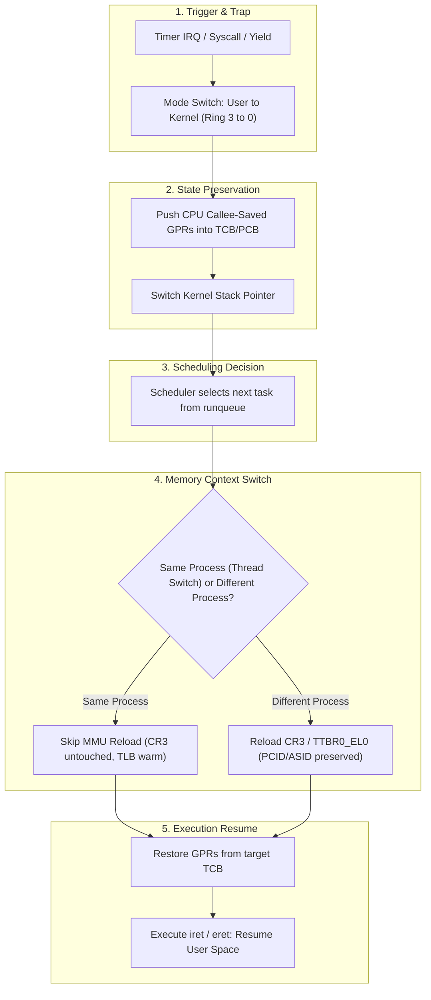

### 4.4 Thread-Local Storage (TLS) Architecture: GS/FS & TPIDR Registers
How does a compiler implement `__thread` or `thread_local` variables without locking?

Each thread requires private storage for variables declared thread-local. On 64-bit architectures, passing or looking up a thread ID via a hashtable on every variable access would be unacceptably slow.
Instead, processors allocate a hardware segment or system register specifically designated as the **Thread Pointer**:
- **x86_64**: Uses the `FS` or `GS` segment registers. In 64-bit mode, segmentation is disabled, but `FS` and `GS` base addresses can be written with arbitrary 64-bit pointers via Model-Specific Registers (`IA32_FS_BASE` / `IA32_GS_BASE`) or the `arch_prctl()` system call. Glibc points `%fs` to the Thread Control Block (TCB). A TLS variable is accessed via a constant offset:
  ```assembly
  movq %fs:0x28, %rax   # Access stack canary or TLS variable
  ```
- **ARMv8-A**: Uses the dedicated system register `TPIDR_EL0` (Thread Pointer ID Register, Exception Level 0). Compilers emit:
  ```assembly
  mrs x0, tpidr_el0
  ldr w1, [x0, #16]      # Load TLS variable at offset 16
  ```

### 4.5 Process Lifecycle: Exit States, Zombies & Non-Blocking Reaping
When a child process terminates via `exit()`, the kernel releases its virtual memory pages, file descriptors, and hardware resources. However, the process cannot be completely removed from the kernel process table:
- **Zombie Process**: A terminated process whose exit status code has not yet been read by its parent via `wait()` or `waitpid()`. It occupies a slot in the kernel Process Table. If a parent continuously spawns children without reaping them, the kernel process table fills up, causing **PID Exhaustion** (preventing any new processes from spawning system-wide).
- **Asynchronous Reaping via `SIGCHLD`**: When a child terminates, the kernel delivers `SIGCHLD` to the parent.
- **The Signal Coalescing Trap**: UNIX signals do **NOT** queue. If four children terminate simultaneously while the parent is running, the kernel marks the `SIGCHLD` bit in the parent's pending signal mask once. If the parent executes a single `wait()`, three zombies remain unreaped!

**The Inviolable Signal Handler Pattern**:
```c
#include <signal.h>
#include <sys/wait.h>
#include <errno.h>
#include <string.h>

void sigchld_handler(int sig)
{
    (void)sig;
    int saved_errno = errno; /* CRITICAL: Preserve errno across signal handlers! */
    int status;
    pid_t pid;

    /* Loop until waitpid returns 0 (children running) or -1 (no more children) */
    while((pid = waitpid(-1, &status, WNOHANG)) > 0)
    {
        /* Child reaped asynchronously */
    }

    errno = saved_errno;
}
```

### 4.6 UNIX Signal Semantics: Reentrancy, Interrupted Syscalls (`EINTR`) & Watchdogs
A signal is an asynchronous software interrupt delivered directly to a thread's execution context.
1. **Async-Signal-Safety**: A signal handler can preempt thread execution between any two machine instructions. Therefore, invoking non-reentrant functions (e.g., `malloc()`, `free()`, `printf()`, or locking a standard mutex) inside a signal handler is strictly **undefined behavior**. If the thread was preempted while holding `malloc`'s internal lock, invoking `malloc` in the signal handler results in instant self-deadlock!
2. **Interrupted System Calls (`EINTR`)**: Slow system calls (e.g., `read()` on a socket or pipe, `waitpid()`) blocked when a signal arrives will abort and return `-1` with `errno` set to `EINTR`. Systems software must wrap blocking calls in defensive retry loops:
   ```c
   ssize_t n;
   do
   {
       n = read(fd, buf, sizeof(buf));
   } while(n < 0 && errno == EINTR);
   ```

### 4.7 File Descriptor Duplication & I/O Redirection (`dup2`)
Shells and container runtimes redirect standard streams (stdin, stdout, stderr) using `dup2(int oldfd, int newfd)`:
- `dup2()` atomically closes `newfd` (if open) and assigns `newfd` to point to the open file table entry referenced by `oldfd`.

```c
/* Redirect stdout (fd 1) to an output file */
int fd = open("output.log", O_WRONLY | O_CREAT | O_TRUNC, 0644);
if(fd >= 0)
{
    dup2(fd, STDOUT_FILENO); /* fd 1 now writes to output.log */
    close(fd);               /* Close redundant descriptor */
}
```


---

## Chapter 5: UNIX Pipes & Kernel Stream IPC

### 5.1 Kernel Implementation of Pipes: The Circular Buffer Inode
A POSIX pipe created via `pipe(int fds[2])` is a unidirectional, in-memory stream managed by the operating system kernel. Unlike regular files, a pipe has no permanent backing store on disk. Internally, the kernel allocates an anonymous inode paired with a **circular kernel buffer** (typically 64 KB on Linux, 16 KB on macOS).

The system call returns two file descriptors referencing this kernel buffer:
- `fds[0]` (`READ_FD`): The read descriptor.
- `fds[1]` (`WRITE_FD`): The write descriptor.

```c
#define READ_FD  0
#define WRITE_FD 1

int pfd[2];
if(pipe(pfd) == -1)
{
    perror("pipe");
    exit(EXIT_FAILURE);
}
```

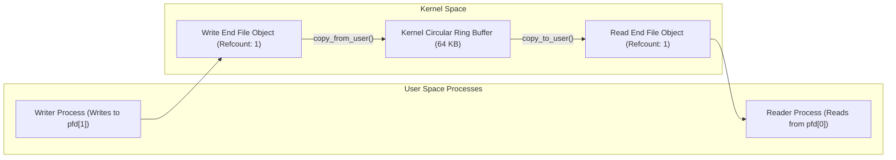

### 5.2 Reference-Counted Endpoints & The Phantom Writer Deadlock
Every file descriptor created by `pipe()` points to an internal kernel file description object that maintains a **reference count**:
- The read end of a pipe delivers an **End-of-File (`EOF`)**—causing `read()` to return `0` bytes—**if and only if all write descriptors referencing the pipe across the entire operating system have been closed**.
- As long as even a single write descriptor remains open in any process, `read()` will block indefinitely if the kernel buffer is empty, waiting for potential incoming data.

#### The Phantom Writer Bug:
When a parent forks child processes to construct a pipeline (e.g., `cmd1 | cmd2`), **both endpoints are duplicated into the child's file descriptor table**.
If the parent or a reader child forgets to close its inherited write descriptor (`pfd[WRITE_FD]`), the kernel write reference count never drops to zero!

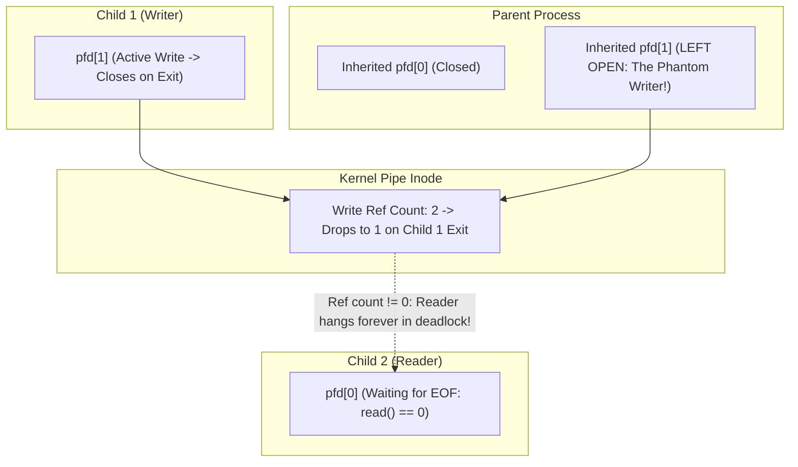

**The Inviolable Architectural Rule of Pipelines**:
Immediately following a `fork()`, **both parent and child must close every pipe descriptor they do not explicitly intend to read from or write to**.

### 5.3 Broken Pipes: `SIGPIPE` Delivery, `EPIPE` & Network Socket Parallels
What happens when a process attempts to write to a pipe or TCP socket whose read endpoint has been closed by the peer?

1. The kernel detects that zero reading processes exist for the target inode.
2. The kernel generates the **`SIGPIPE`** signal and delivers it to the writing process.
3. **The Fatal Default**: The default disposition of `SIGPIPE` is **immediate process termination (kill)** without generating a core dump!
4. If the process has ignored `SIGPIPE` (`signal(SIGPIPE, SIG_IGN);`), the `write()` system call returns `-1` with `errno` explicitly set to **`EPIPE` (Broken Pipe)**.

```c
/* Mandatory defensive pattern for network servers and streaming pipelines */
void setup_robust_ipc_signals(void)
{
    struct sigaction sa;
    memset(&sa, 0, sizeof(sa));
    sa.sa_handler = SIG_IGN; /* Ignore SIGPIPE */
    sigemptyset(&sa.sa_mask);
    sa.sa_flags = 0;
    sigaction(SIGPIPE, &sa, NULL);
}

/* In writing routine: */
ssize_t bytes_written = write(fd, payload, size);
if(bytes_written < 0)
{
    if(errno == EPIPE)
    {
        /* Peer cleanly closed connection: teardown gracefully */
        close(fd);
    }
}
```

### 5.4 Atomicity Guarantees: `PIPE_BUF` & Interleaved Data Streams
When multiple writer processes write concurrently to a single shared pipe (e.g., multiple worker loggers writing to a central logging daemon):
- POSIX guarantees that writes of up to **`PIPE_BUF` bytes** (4,096 bytes on Linux; 512 bytes strictly mandated by POSIX) are **guaranteed atomic**.
- If a write is $\le \text{PIPE\_BUF}$, the kernel writes the entire payload contiguously into the circular buffer. No other process's data can interleave between those bytes.
- If a write exceeds `PIPE_BUF` (e.g., an 8 KB write), the kernel may fragment the write into multiple chunks, allowing concurrent writes from other processes to **interleave**, corrupting output streams!

### 5.5 Bidirectional IPC & Multi-Process Communication Topologies
Pipes are strictly **unidirectional**. Constructing a bidirectional request-response channel between two processes requires **two independent pipes**:
- `Pipe_A` (Parent Write $\to$ Child Read)
- `Pipe_B` (Child Write $\to$ Parent Read)

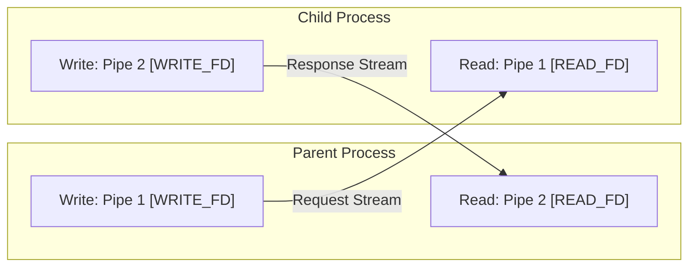

---

## Chapter 6: Concurrency, Thread Synchronization & Memory Consistency Models

### 6.1 Condition Variables: Hoare vs Mesa Semantics & The Spurious Wakeup Invariant
Condition variables provide thread synchronization based on data state changes. A condition variable is **stateless**; it does not store counts or flags. It must always be paired with a mutual exclusion lock (`pthread_mutex_t`).

#### Hoare vs Mesa Semantics:
1. **Hoare Semantics**: When a signaling thread calls `signal()`, the waiting thread immediately preempts the signaler and executes instantly while the condition is guaranteed to be true. (Rarely implemented in production OS kernels because it forces an immediate double context-switch).
2. **Mesa Semantics (Standard POSIX / Windows / Java)**: When `pthread_cond_signal()` is called, the waiting thread is moved from the condition variable's wait queue to the mutex's ready/contention queue. The signaler continues executing. By the time the awakened thread acquires the mutex, an intervening third thread may have entered and modified the state!

Furthermore, operating system kernels reserve the right to deliver **Spurious Wakeups**—waking a waiting thread even if zero signals were broadcast (e.g., during signal handling or kernel preemption transitions).

**The Inviolable Law of Condition Variables**:
A condition variable MUST ALWAYS be evaluated inside a `while` loop, **never an `if` statement**:

```c
/* FLAWED DESIGN: Vulnerable to Mesa races and spurious wakeups */
pthread_mutex_lock(&lock);
if(!work_ready)
{
    pthread_cond_wait(&cv, &lock);
}
process_work(); /* BUG: work_ready could be false here! */
pthread_mutex_unlock(&lock);

/* ARCHITECTURALLY CORRECT: Mesa-safe loop */
pthread_mutex_lock(&lock);
while(!work_ready)
{
    /* Atomically unlocks the mutex and puts thread to sleep */
    pthread_cond_wait(&cv, &lock);
    /* Upon waking, lock is re-acquired BEFORE condition is re-tested */
}
process_work();
pthread_mutex_unlock(&lock);
```

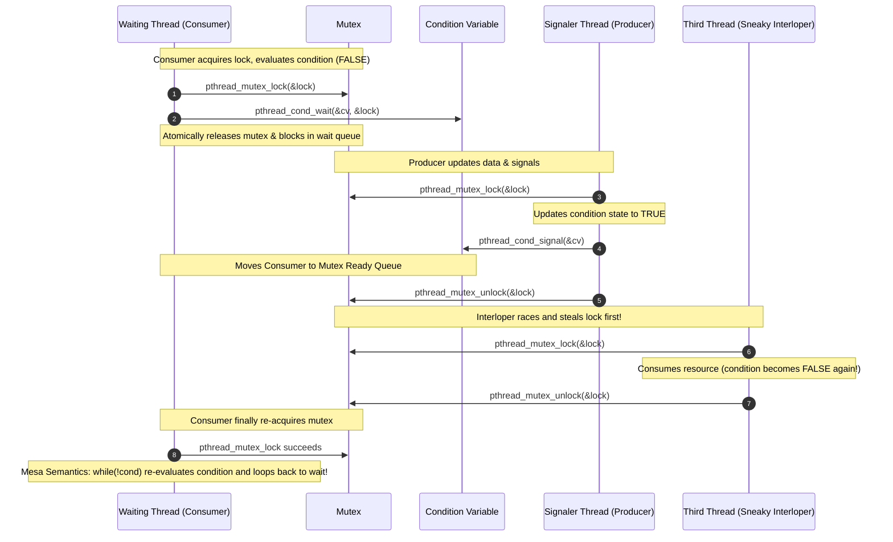

### 6.2 Mutual Exclusion vs Counting Semaphores: Ownership & ISR Safety
The distinction between a mutex and a binary semaphore is a frequent point of confusion in systems design:

| Architectural Metric | Mutex (`pthread_mutex_t`) | Semaphore (`sem_t`) |
| :--- | :--- | :--- |
| **Ownership Invariant** | **Strict Ownership**: The exact thread that locked the mutex MUST unlock it. | **No Ownership**: Any thread, process, or ISR can call `sem_post()` to increment the count. |
| **Priority Inversion** | Can be prevented via **Priority Inheritance Protocol (PIP)**. | **Cannot** support Priority Inheritance because the semaphore has no concept of owner identity! |
| **Recursive Locking** | Supported via `PTHREAD_MUTEX_RECURSIVE`. | Non-applicable (increments/decrements integer state). |
| **ISR / Signal Safety** | **STRICTLY FORBIDDEN** in Interrupt Service Routines (ISRs cannot block). | `sem_post()` is **Async-Signal-Safe** and allowed in ISRs to signal worker threads. |

### 6.3 Real-Time Scheduling Hazards: Priority Inversion & The Mars Pathfinder Case
Priority Inversion is a catastrophic concurrency failure mode that occurs when a high-priority task is indirectly preempted and starved by a medium-priority task.

#### The Real-World Failure:
In 1997, the Mars Pathfinder spacecraft's information bus experienced continuous real-time resets.
1. A Low-priority meteorological task ($L$) acquired a shared mutex $M$.
2. The High-priority attitude control task ($H$) woke up and requested mutex $M$. Since $M$ was held by $L$, task $H$ blocked.
3. A Medium-priority communications task ($M_{ed}$) arrived. It did not require mutex $M$. Because $M_{ed}$ had higher priority than $L$, the CPU scheduler preempted $L$ to run $M_{ed}$.
4. **The Hazard**: Because $L$ was preempted, it could not finish its work to release mutex $M$. As a result, the High-priority task $H$ was starved indefinitely by the Medium-priority task $M_{ed}$, reversing the intended priority hierarchy! The watchdog timer expired and reset the spacecraft.

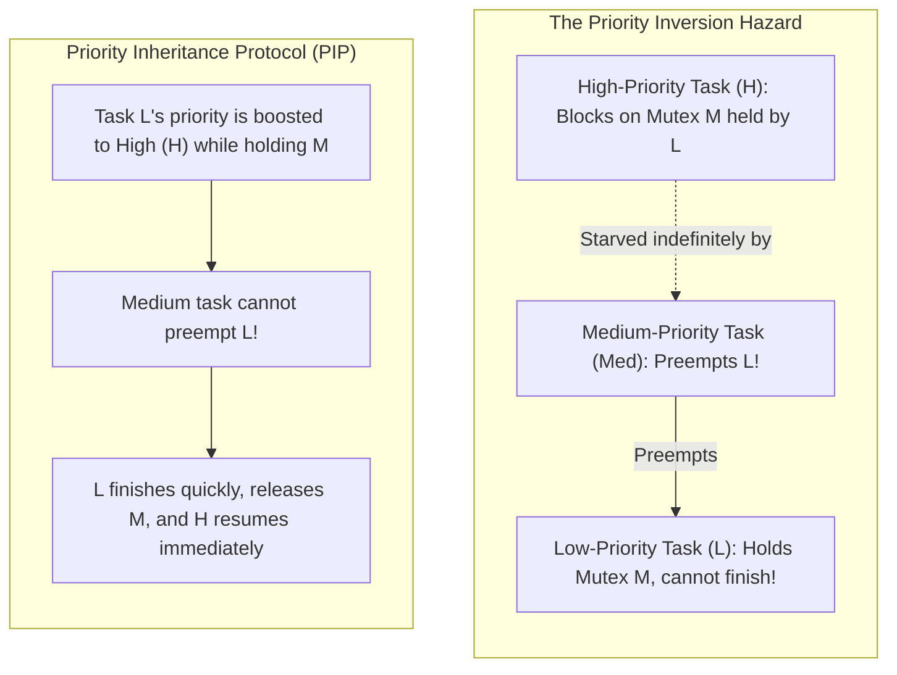

#### The Architectural Solutions:
1. **Priority Inheritance Protocol (PIP)**: When a high-priority thread blocks on a mutex held by a low-priority thread, the OS temporarily boosts the low-priority thread's priority to match the high-priority thread until the mutex is released (`pthread_mutexattr_setprotocol(&attr, PTHREAD_PRIO_INHERIT);`).
2. **Priority Ceiling Protocol (PCP)**: Every mutex is assigned a static ceiling priority equal to the highest priority task that can ever lock it. Any thread that locks the mutex is instantly elevated to that ceiling priority.

### 6.4 Reader-Writer Synchronization: Writer Starvation & Writer-Preference RWLocks
Standard reader-writer locks (`pthread_rwlock_t`) allow multiple concurrent readers to access shared data simultaneously while restricting writers to exclusive access.

However, default implementations often exhibit **Reader Preference**. If a steady succession of reader threads arrives, a waiting writer can be starved indefinitely.
To guarantee bounded latency for writers, a systems engineer must implement a **Writer-Preference RWLock**:
- If `waiting_writers > 0`, all subsequent reader attempts must **block**, allowing currently executing readers to drain and the writer to take ownership immediately.

```c
typedef struct
{
    pthread_mutex_t lock;
    pthread_cond_t read_cv;
    pthread_cond_t write_cv;
    int active_readers;
    int active_writers;
    int waiting_writers;
} WriterPrefRwLock;

void rwlock_read_lock(WriterPrefRwLock *rw)
{
    pthread_mutex_lock(&rw->lock);
    /* Block if a writer is active OR if any writer is waiting (Writer Preference!) */
    while(rw->active_writers > 0 || rw->waiting_writers > 0)
    {
        pthread_cond_wait(&rw->read_cv, &rw->lock);
    }
    rw->active_readers++;
    pthread_mutex_unlock(&rw->lock);
}

void rwlock_write_lock(WriterPrefRwLock *rw)
{
    pthread_mutex_lock(&rw->lock);
    rw->waiting_writers++;
    /* Block if any reader is active OR if another writer is active */
    while(rw->active_readers > 0 || rw->active_writers > 0)
    {
        pthread_cond_wait(&rw->write_cv, &rw->lock);
    }
    rw->waiting_writers--;
    rw->active_writers = 1;
    pthread_mutex_unlock(&rw->lock);
}

void rwlock_write_unlock(WriterPrefRwLock *rw)
{
    pthread_mutex_lock(&rw->lock);
    rw->active_writers = 0;
    /* Prioritize waiting writers first; otherwise wake waiting readers */
    if(rw->waiting_writers > 0)
    {
        pthread_cond_signal(&rw->write_cv);
    }
    else
    {
        pthread_cond_broadcast(&rw->read_cv);
    }
    pthread_mutex_unlock(&rw->lock);
}
```

```mermaid
stateDiagram-v2
    [*] --> Idle: Lock Initialized
    Idle --> Reading: read_lock (active_readers > 0)
    Reading --> Reading: Additional read_lock (waiting_writers == 0)
    Reading --> Idle: read_unlock (active_readers == 0)

    Reading --> WriterPending: write_lock called (waiting_writers > 0)
    note right of WriterPending: Writer Preference: New readers block!
    WriterPending --> Writing: Last reader unlocks (active_readers == 0)

    Idle --> Writing: write_lock called (active_writers == 1)
    Writing --> Idle: write_unlock (wakes waiting writers, then readers)
```

### 6.5 Deadlock Theory: Coffman Conditions & Dijkstra's Total Resource Ordering
In 1971, Edward Coffman Jr. proved that a system deadlock can occur **if and only if all four of the following conditions hold simultaneously**:
1. **Mutual Exclusion**: Resources cannot be shared; each resource is held by at most one thread at a time.
2. **Hold and Wait**: Threads currently holding allocated resources can request additional resources without releasing their existing holdings.
3. **No Preemption**: Resources cannot be forcibly revoked from a thread; they can only be released voluntarily by the holding thread.
4. **Circular Wait**: A closed chain of threads exists such that each thread holds a resource requested by the next thread ($T_1 \to R_2 \to T_2 \to R_1 \to T_1$).

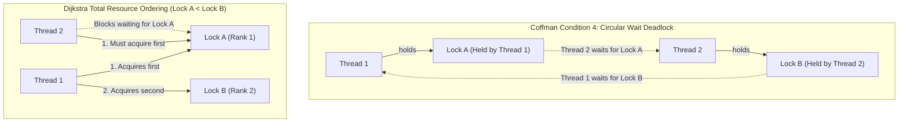

#### Mathematical Proof of Dijkstra's Total Resource Ordering:
To prevent deadlocks architecturally, we mathematically break Coffman Condition 4 (Circular Wait).
- Define a strict partial or total ordering function $f: \mathcal{R} \to \mathbb{N}$ over all system locks such that every lock is assigned a unique integer rank.
- **The Invariant**: A thread holding lock $R_i$ is permitted to request lock $R_j$ **if and only if** $f(R_j) > f(R_i)$.
- **Proof by Contradiction**: Suppose a circular wait chain exists: $T_1 \to R_1 \to T_2 \to R_2 \dots \to R_n \to T_1$.
  By our ordering invariant, this implies:
  $$f(R_1) < f(R_2) < \dots < f(R_n) < f(R_1)$$
  This yields $f(R_1) < f(R_1)$, which is a logical contradiction. Therefore, circular wait is mathematically impossible under total resource ordering.

### 6.6 The Hardware Memory Model: C11 `stdatomic` & Acquire-Release Consistency
Modern processors (x86, ARM, RISC-V) and optimizing compilers aggressively reorder memory reads and writes to keep execution pipelines saturated. Store buffers, invalidation queues, and speculative execution mean that the order in which memory stores occur in code is **not** necessarily the order in which they are observed by other CPU cores.

The C11 standard defines explicit memory orders to specify hardware synchronization boundaries:

| Memory Ordering | Hardware Barrier Semantics | Microarchitectural Overhead | Canonical Use Case |
| :--- | :--- | :--- | :--- |
| `memory_order_relaxed` | Guarantees **atomicity** of the variable itself, but enforces **ZERO ordering or synchronization constraints** on surrounding memory operations. | Free on all architectures (standard load/store instruction). | Monotonic counters, statistic counters. |
| `memory_order_acquire` | **Load barrier**: No subsequent memory reads or writes in program order can be reordered **BEFORE** this read. Synchronizes with an `acquire` or `release` store in another thread. | Free on x86 (x86 hardware loads have implicit acquire semantics). Emits `dmb ld` / `ldar` on ARM. | Lock acquisition, reading published pointers. |
| `memory_order_release` | **Store barrier**: No prior memory reads or writes in program order can be reordered **AFTER** this write. All prior stores become visible to threads executing an `acquire` load on this location. | Free on x86 (x86 hardware stores have implicit release semantics). Emits `dmb ish` / `stlr` on ARM. | Lock release, publishing data to consumers. |
| `memory_order_acq_rel` | Combines both Acquire and Release constraints on a single Read-Modify-Write (RMW) instruction. | Generates bus locked instruction (`lock cmpxchg`) on x86; `ldaxr`/`stlxr` loops on ARM. | Atomic spinlock swap, atomic reference counting decrements. |
| `memory_order_seq_cst` | **Sequential Consistency**: Guarantees a single globally consistent execution order observed by all cores across the entire system. | Extremely expensive: enforces full memory fences (`mfence` on x86, `dmb ish` on ARM). | Default C11/C++ atomics; general multithreading. |

### 6.7 Multiprocessor Cache Coherence: The MESI Protocol & TTAS Spinlocks
On multi-core symmetric multiprocessing (SMP) systems, each core maintains private L1 and L2 caches. To maintain consistent state, the hardware interconnect runs the **MESI Cache Coherency Protocol**:
- **M (Modified)**: Cache line is present only in this core's cache and is dirty (differs from main DRAM). This core has exclusive write permission.
- **E (Exclusive)**: Cache line is present only in this core's cache and is clean (matches DRAM).
- **S (Shared)**: Cache line is clean and present in multiple cores' caches simultaneously (read-only mode).
- **I (Invalid)**: Cache line contains stale data and cannot be read.

#### The TAS Spinlock Flaw: Bus Invalidation Storms:
```c
/* NAIVE TAS (Test-And-Set) SPINLOCK: Severe hardware performance flaw */
void spinlock_lock_flawed(atomic_flag *lock)
{
    while(atomic_flag_test_and_set(lock))
    {
        /* Busy wait: Executes atomic write on EVERY clock cycle */
    }
}
```
In this naive TAS spinlock, every spinning core executes an atomic test-and-set instruction (`lock bts` or `cmpxchg`). Every attempt issues a **Bus Invalidation Request**, invalidating the cache line across all other CPU cores. This saturates the CPU interconnect with coherency traffic, stalling other cores from executing meaningful work.

#### The TTAS (Test-and-Test-and-Set) Solution:
```c
void spinlock_lock_ttas(atomic_flag *lock)
{
    while(1)
    {
        /* 1. Read-only spin: The cache line stays in Shared (S) state in private L1 cache.
         * Zero bus traffic is generated while spinning! */
        while(atomic_load_explicit((_Atomic bool *)lock, memory_order_relaxed) == true)
        {
            #if defined(__x86_64__)
            __builtin_ia32_pause(); /* Low-power pipeline pause; prevents pipeline thrashing */
            #elif defined(__aarch64__)
            __asm__ volatile("yield");
            #endif
        }

        /* 2. Lock appears free: Attempt atomic acquisition once */
        if(!atomic_flag_test_and_set_explicit(lock, memory_order_acquire))
        {
            return; /* Lock acquired successfully */
        }
    }
}

void spinlock_unlock_ttas(atomic_flag *lock)
{
    atomic_flag_clear_explicit(lock, memory_order_release);
}
```


---

## Chapter 7: Memory Hierarchy, CPU Caches & Hardware Performance

### 7.1 The Von Neumann Memory Wall: Latency Pyramid across Microarchitectures
Since the early 1980s, CPU compute performance has advanced at a compound rate far exceeding DRAM access speeds—a phenomenon known in computer architecture as the **Memory Wall**. While a modern CPU core can execute 3–5 instructions per clock cycle at frequencies exceeding 4.0 GHz, fetching a single byte from external DRAM requires approximately 50–80 nanoseconds (equivalent to 150–250 CPU clock cycles).

To prevent the execution pipeline from idling during memory fetches, modern microprocessors introduce a hierarchical cache subsystem:

| Subsystem Level | Typical Storage Capacity | Latency (Clock Cycles) | Latency (Absolute Time) | Human-Scale Equivalent (1 cycle $\approx$ 1 sec) |
| :--- | :--- | :--- | :--- | :--- |
| **CPU Registers** | ~1–2 KB | 0–1 cycles | $< 0.3 \text{ ns}$ | 1 second |
| **L1 Data / Instruction Cache** | 32–48 KB per core | 3–5 cycles | $\approx 1.0 \text{ ns}$ | 4 seconds |
| **L2 Unified Cache** | 512 KB – 1 MB per core | 12–14 cycles | $\approx 3.5 \text{ ns}$ | 14 seconds |
| **L3 Last-Level Cache (LLC)** | 16–64+ MB (Shared across cores) | 40–60 cycles | $\approx 12–15 \text{ ns}$ | 1 minute |
| **Main Memory (DRAM)** | 16–256+ GB | 150–250 cycles | $\approx 50–80 \text{ ns}$ | 3.5 minutes |
| **NVMe Solid-State Disk** | 1–4+ TB | 50,000–200,000 cycles | $\approx 15–60 \ \mu\text{s}$ | 1.5 days |
| **Rotational HDD / Network SAN**| Multiple TBs | 10,000,000+ cycles | $\approx 3–10 \text{ ms}$ | 3.8 months |

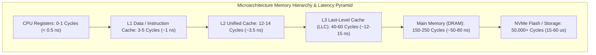

### 7.2 Cache Line Anatomy: Tags, Sets & Offset Mapping
Main memory is partitioned into uniform blocks called **Cache Lines**, which are standardized at **64 bytes** across modern x86_64 and ARMv8 microarchitectures. When a program reads a single 8-bit integer, the memory controller transfers the entire 64-byte aligned block encompassing that byte into the cache hierarchy.

To locate whether a target memory address is resident in the cache, the hardware divides the 64-bit physical address into three distinct bitfields:
1. **Offset (`OffsetBits = \log_2(64) = 6` bits, bits [5:0])**: Determines the specific byte within the 64-byte line.
2. **Set Index (`IndexBits = \log_2(\text{Number of Sets})`, e.g., bits [16:6] for an 11-bit index)**: Directs the address to a specific cache set.
3. **Tag (Remaining upper bits)**: Stored alongside the data in the cache set to uniquely verify if the cached line matches the requested memory block.

In an $N$-way set-associative cache, each set contains $N$ independent cache line slots (ways). The hardware simultaneously compares the Tag of the incoming address against all $N$ ways in parallel.

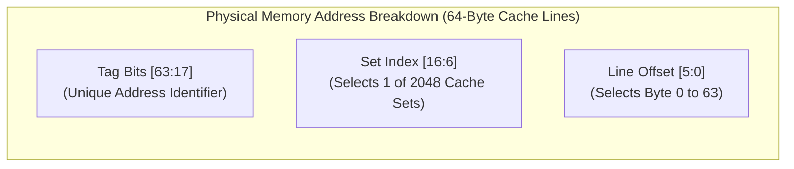

### 7.3 The 4 C's of Cache Misses: Compulsory, Capacity, Conflict & Coherence
In computer architecture theory (pioneered by Mark Hill and expanded by Hennessy & Patterson), every cache miss falls into one of four distinct categories:

1. **Compulsory (Cold) Miss**:
   - *Cause*: The very first time a memory block is referenced by the CPU. The block has never resided in cache.
   - *Mitigation*: Unavoidable in theory; mitigated in practice by hardware stream prefetchers (which detect sequential access strides and load upcoming cache lines into L1/L2 ahead of execution) or explicit software prefetch instructions (`__builtin_prefetch()`).
2. **Capacity Miss**:
   - *Cause*: The active working set of the program exceeds the aggregate capacity of the cache. Even if the cache were fully associative, lines must be evicted to make room for new data.
   - *Mitigation*: Cache blocking (loop tiling) algorithms; compressing data structures; Struct-of-Arrays (SoA) layout.
3. **Conflict (Collision) Miss**:
   - *Cause*: Multiple memory addresses map to the **exact same cache set**, causing lines to evict each other repeatedly even though the overall cache has substantial empty capacity in other sets.
   - *Common Trigger*: Traversing data structures with strides that are exact powers of two (e.g., $2^{12} = 4096$ byte stride), where all addresses share the exact same low-order set index bits!
   - *Mitigation*: Prime-sized array padding; avoiding exact power-of-two stride lengths in multi-dimensional matrices.
4. **Coherence Miss**:
   - *Cause*: In a multi-core symmetric multiprocessing (SMP) system, an otherwise valid cache line is invalidated because another CPU core executed a write to that cache line (governed by the MESI protocol).
   - *True Sharing Miss*: Two cores read and write the exact same shared variable.
   - *False Sharing Miss*: Two cores read and write completely different variables that happen to share the same 64-byte cache line.

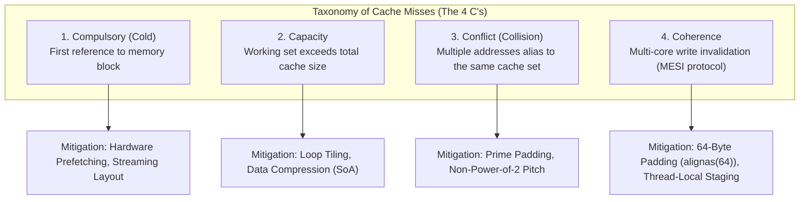

### 7.4 Spatial and Temporal Locality: Row-Major vs Column-Major Access & Pointer Chasing
The performance of software running on modern hardware is primarily dictated by **locality of reference**:
- **Temporal Locality**: Memory accessed recently is likely to be accessed again soon (e.g., loop induction variables, stack tops).
- **Spatial Locality**: Memory located physically adjacent to recently accessed memory is likely to be accessed soon.

#### The Matrix Traversal Experiment (Row-Major vs Column-Major):
In C, two-dimensional arrays are stored contiguously in **Row-Major Order** (row 0 elements, followed immediately by row 1 elements):

```c
#define MATRIX_ROWS 8192
#define MATRIX_COLS 8192
static uint64_t matrix[MATRIX_ROWS][MATRIX_COLS];

/* DESIGN A: Spatial Locality Optimized (Row-Major Traversal) */
void traverse_row_major(void)
{
    for(size_t r = 0; r < MATRIX_ROWS; r++)
    {
        for(size_t c = 0; c < MATRIX_COLS; c++)
        {
            matrix[r][c] += 1;
        }
    }
}

/* DESIGN B: Cache-Thrashing Catastrophe (Column-Major Traversal) */
void traverse_column_major(void)
{
    for(size_t c = 0; c < MATRIX_COLS; c++)
    {
        for(size_t r = 0; r < MATRIX_ROWS; r++)
        {
            matrix[r][c] += 1;
        }
    }
}
```

#### Microarchitectural Analysis:
- In `traverse_row_major()`, memory is accessed with a stride of 1 word (8 bytes). When `matrix[r][0]` is loaded, the hardware fetches a 64-byte cache line containing `matrix[r][0]` through `matrix[r][7]`. The next 7 inner loop iterations achieve **100% L1 Cache Hits**. Cache line utilization is **100%**. The hardware prefetcher recognizes the linear stride and streams subsequent cache lines into L1d cache.
- In `traverse_column_major()`, each inner loop iteration advances by $8192 \times 8 = 65,536$ bytes. Every single access maps to a new 64-byte cache line, causing a **Cache Miss on EVERY iteration**. Only 8 bytes out of every 64-byte fetched line are utilized (**12.5% cache efficiency**). Furthermore, because the stride is $64\text{ KB} = 2^{16}$ (a power of two), every access hashes to the exact same cache set index, generating continuous **Conflict Misses** and evicting recently fetched lines. In production benchmarks, `traverse_row_major()` runs **15x to 30x faster** than `traverse_column_major()`.

#### Pointer Chasing in Linked Lists vs Contiguous Arrays:
A linked list allocates nodes via separate calls to `malloc()`, dispersing nodes across non-contiguous physical addresses in heap memory. Traversing a linked list (`curr = curr->next`) requires **pointer chasing**:
1. The CPU cannot predict the address of `curr->next` until the current node's memory is retrieved from DRAM.
2. The hardware prefetcher is rendered completely ineffective because memory access addresses are non-linear.
3. Every node traversal stalls the CPU execution pipeline for 150–250 clock cycles waiting for DRAM.
In contrast, traversing a contiguous flat buffer (`uint8_t buffer[]`) enables the hardware stream prefetcher to fetch data hundreds of cycles ahead of execution, masking memory latency entirely.

### 7.5 Memory Alignment Penalties: Split-Line Access & Hardware Alignment Faults
The CPU memory execution unit enforces **Natural Alignment**:
- A 2-byte integer (`int16_t`) must align to an even address (`addr % 2 == 0`).
- A 4-byte integer (`int32_t`) must align to an address divisible by 4 (`addr % 4 == 0`).
- An 8-byte integer (`int64_t` or pointer) must align to an address divisible by 8 (`addr % 8 == 0`).

#### The Microarchitectural Cost of Misalignment:
1. **Misaligned within a Single Cache Line**: Modern x86_64 and ARMv8 CPUs handle misaligned loads transparently via microcode shifting logic, incurring a minor 1–2 clock cycle penalty.
2. **Misaligned Across a 64-Byte Cache Line Boundary ("Split-Line Access")**:
   If an 8-byte integer starts at byte offset 60 of a 64-byte cache line:
   - Bytes 0–3 reside in Cache Line $K$.
   - Bytes 4–7 reside in Cache Line $K+1$.
   To execute this single load, the CPU must issue **two independent cache access operations**, merge the two slices in the execution register, and handle cross-line consistency.
3. **The Split-Lock Hazard**: If a misaligned access crossing a cache line boundary is executed with an atomic prefix (`lock cmpxchg`), the processor cannot use standard cache-coherency lock mechanisms (which operate strictly at the 64-byte line granularity). Historically, x86 processors asserted the hardware **`LOCK#` bus signal**, locking the external memory bus and stalling memory transactions across **ALL cores** on the socket. Modern Linux kernels detect split-locks and log warnings or terminate the offending process via `SIGBUS` (`/proc/sys/kernel/split_lock_mitigate`).
4. **Hardware Alignment Faults**: On strict RISC architectures (e.g., MIPS, SPARC, or ARMv8 with alignment checking enabled via `SCTLR_EL1.A = 1`), an unaligned memory access does not incur a performance penalty—it generates an immediate **Hardware Alignment Fault Exception**, delivering `SIGBUS` and crashing the application.

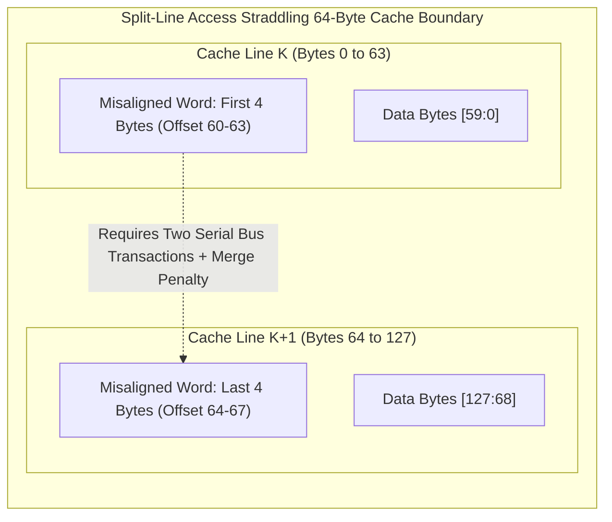

### 7.6 Elimination of False Sharing: Microarchitectural Analysis & `alignas(64)`
False sharing is one of the most pernicious performance bugs in concurrent systems engineering. It occurs when two threads running on distinct CPU cores read and write distinct variables that reside within the **same 64-byte cache line**.

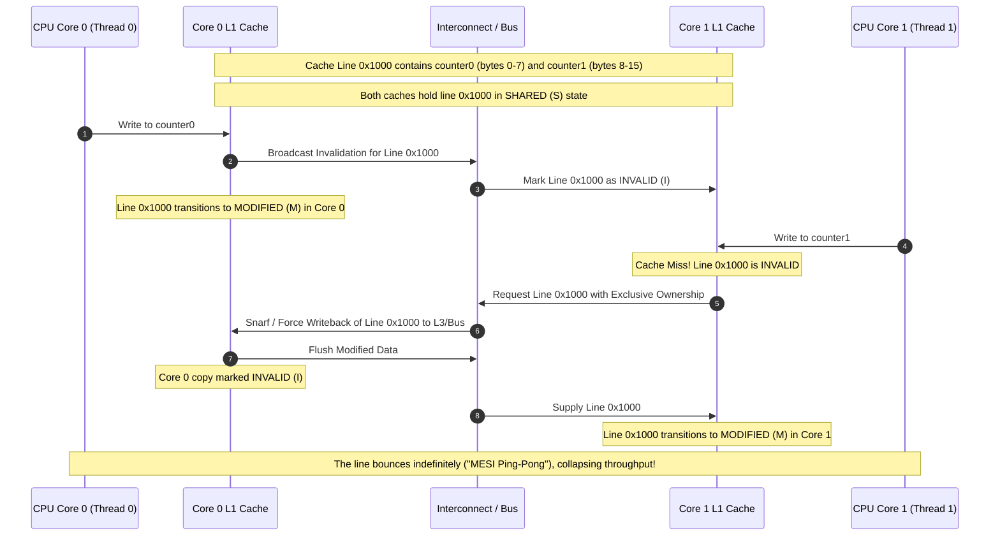

#### Production C Implementation:
To eliminate false sharing, systems software aligns each thread-local counter to a 64-byte cache boundary using C11 `alignas` or GCC/Clang `__attribute__((aligned(64)))`:

```c
#include <stdalign.h>
#include <stdint.h>
#include <stdatomic.h>

#define CACHE_LINE_SIZE 64U

/* FLAWED DESIGN: counter0 and counter1 share a single 64-byte cache line */
typedef struct
{
    _Atomic uint64_t counter0; /* Bytes 0-7  */
    _Atomic uint64_t counter1; /* Bytes 8-15 */
} FlawedCounters;

/* ARCHITECTURALLY CORRECT: Separated across distinct cache lines */
typedef struct
{
    alignas(CACHE_LINE_SIZE) _Atomic uint64_t counter0;
    uint8_t pad0[CACHE_LINE_SIZE - sizeof(_Atomic uint64_t)];

    alignas(CACHE_LINE_SIZE) _Atomic uint64_t counter1;
    uint8_t pad1[CACHE_LINE_SIZE - sizeof(_Atomic uint64_t)];
} AlignedCounters;
```

---

## Chapter 8: Virtual Memory, Multi-Level Page Tables & The MMU

### 8.1 The Virtual-to-Physical Address Translation Abstraction
Virtual memory provides two indispensable systems abstractions:
1. **Address Space Virtualization**: Every process is granted a uniform, contiguous linear address space, decoupling the programmer from physical DRAM fragmentation.
2. **Memory Protection & Sandboxing**: Page-level permissions prevent user programs from reading or corrupting kernel memory or the memory of other processes.

The CPU hardware executes all instructions using **Virtual Addresses (VA)**. The on-chip **Memory Management Unit (MMU)** translates every Virtual Address into a **Physical Address (PA)** before issuing transactions to the memory controller:

```mermaid
flowchart LR
    CPU["CPU Core: Generates Virtual Address (VA)"] --> MMU["Hardware MMU: Translates VA to PA"]
    MMU --> TLB{"TLB Lookup"}
    TLB -->|"Hit (1-2 cycles)"| PA["Physical Address (PA)"]
    TLB -->|"Miss"| Walker["Hardware Page Table Walker (4 Memory Accesses)"]
    Walker --> PA
    PA --> MemoryController["DRAM Memory Controller"]
```

#### The Geometry of Page Translation:
In standard systems, physical DRAM is partitioned into 4,096-byte ($4\text{ KB} = 2^{12}\text{ bytes}$) blocks called **Page Frames**.
A 48-bit canonical Virtual Address is split mathematically into two components:
- **Virtual Page Number (VPN, upper 36 bits)**: Translated by the MMU into a Physical Frame Number (PFN).
- **Page Offset (lower 12 bits, `VA[11:0]`)**: Points to the exact byte within the 4KB frame.
**The Golden Invariant**: The page offset is **NEVER translated**. It passes directly through to the physical address:
$$\text{PA}[11:0] \equiv \text{VA}[11:0]$$

```mermaid
flowchart LR
    subgraph VA_Split["48-Bit Canonical Virtual Address (4 KB Page)"]
        VPN["Virtual Page Number: Bits [47:12] (36 Bits Translated by MMU)"]
        Offset["Page Offset: Bits [11:0] (12 Bits Untranslated)"]
    end

    subgraph PA_Split["Physical Memory Address"]
        PFN["Physical Frame Number: Bits [51:12] (Supplied by PTE)"]
        PA_Offset["Page Offset: Bits [11:0] (Identical to VA Offset)"]
    end

    VPN -->|"MMU Page Table Walk"| PFN
    Offset -->|"Passes directly through"| PA_Offset
```

### 8.2 Multi-Level Paging Architecture: Sparse Radix Trees (x86_64 & ARMv8)
Why do modern operating systems use multi-level hierarchical page tables instead of a single flat array?
- A flat page table for a 48-bit address space would contain $2^{36}$ entries. With each entry consuming 8 bytes, a flat page table would require:
  $$2^{36} \times 8\text{ bytes} = 512\text{ Gigabytes of RAM per process!}$$
- Most processes use only a tiny fraction of their 48-bit address space (code at low addresses, heap growing upward, stack at high addresses, with a massive unmapped void in between).

A **Multi-Level Page Table** is an on-demand, sparse radix tree. Intermediate page table levels are allocated **only when a virtual address within that range is actively mapped**. If a 512 GB virtual address region is unused, its corresponding upper-level entry is marked not present (`NULL`), consuming zero bytes of physical RAM for downstream tables.

#### The 4-Level Page Table Walk on x86_64:
On x86_64, a 48-bit Virtual Address is partitioned into four 9-bit indices and a 12-bit offset ($9 + 9 + 9 + 9 + 12 = 48$ bits):
1. The CPU register **`CR3`** holds the physical base address of the top-level table: the **Page Map Level 4 (PML4)**.
2. **Bits [47:39] (9 bits = 512 entries)** index into the PML4, yielding a PML4 Entry (PML4E) that points to a **Page Directory Pointer Table (PDPT)**.
3. **Bits [38:30] (9 bits = 512 entries)** index into the PDPT, yielding a PDPTE that points to a **Page Directory (PD)**.
4. **Bits [29:21] (9 bits = 512 entries)** index into the PD, yielding a PDE that points to a **Page Table (PT)**.
5. **Bits [20:12] (9 bits = 512 entries)** index into the PT, yielding the final **Page Table Entry (PTE)**.
6. The PTE contains the **Physical Frame Number (PFN)**. The MMU concatenates the PFN with the original 12-bit offset (`VA[11:0]`) to construct the final Physical Address.

```mermaid
flowchart LR
    CR3["CR3 Control Register (Physical Base)"] --> PML4["Level 4: PML4 Table (VA[47:39])"]
    PML4 -->|"PML4E"| PDPT["Level 3: PDPT Table (VA[38:30])"]
    PDPT -->|"PDPTE"| PD["Level 2: Page Directory (VA[29:21])"]
    PD -->|"PDE"| PT["Level 1: Page Table (VA[20:12])"]
    PT -->|"PTE (PFN)"| Frame["4 KB Physical DRAM Frame"]
    Frame --> PA["Physical Address = (PFN << 12) | VA[11:0]"]
```

ARMv8-A architecture executes an equivalent 4-level translation walk using `TTBR0_EL0` (user space) and `TTBR1_EL0` (kernel space) across Level 0, Level 1, Level 2, and Level 3 translation tables.

### 8.3 Hardware Page Table Entry (PTE) Architecture & Bitflags
Each entry in a 64-bit page table is an 8-byte word containing physical frame addresses alongside hardware-enforced permission and architectural bitflags:

```
+-----------------------------------------------------------------------------+
| 63 | 62:52 | 51:12                     | 11:9 | 8 | 7  | 6 | 5 | 4 | 3 | 2 | 1 | 0 |
| NX | Avail | Physical Frame Base (PFN) | Avail| G | PS | D | A |PCD|PWT|U/S|R/W| P |
+-----------------------------------------------------------------------------+
```

| Bit Flag | Identifier | Hardware Architectural Semantics |
| :--- | :--- | :--- |
| **Bit 0** | `P` (Present) | `1` if page frame resides in physical RAM; `0` if swapped out to disk or unallocated. Memory access with `P = 0` triggers a hardware **Page Fault Exception (`#PF`)**. |
| **Bit 1** | `R/W` (Read/Write) | `0` = Read-Only; `1` = Read/Write. Enforces immutable code segments (`.text`). Write to a `0` entry triggers a protection fault. |
| **Bit 2** | `U/S` (User/Supervisor) | `0` = Kernel Mode only (Ring 0 / EL1); `1` = User Mode accessible (Ring 3 / EL0). Prevents user applications from reading or corrupting kernel memory. |
| **Bit 3** | `PWT` (Page Write-Through) | `1` = Write-Through caching; `0` = Write-Back caching. |
| **Bit 4** | `PCD` (Page Cache Disable) | **`1` = Bypasses CPU caches completely.** Essential for **MMIO registers** so hardware reads/writes trigger direct bus cycles rather than hitting L1 cache. |
| **Bit 5** | `A` (Accessed) | Set to `1` by CPU hardware whenever the page is read or written. Used by the OS page replacement algorithm (e.g., Clock / LRU) to detect active pages. |
| **Bit 6** | `D` (Dirty) | Set to `1` by CPU hardware whenever a write occurs to the page. Informs the OS swapper whether the physical frame must be written back to disk before eviction. |
| **Bit 7** | `PS` (Page Size) | If `1` at the Page Directory level, this entry maps a **2 MB Huge Page** directly, terminating the walk early! If `1` at PDPT level, maps a **1 GB Huge Page**. |
| **Bit 8** | `G` (Global) | If `1`, prevents the TLB from invalidating this translation when `CR3` is reloaded during a context switch. Used for shared kernel space pages. |
| **Bit 63**| `NX` / `XD` (No-Execute) | **Execute-Disable bit** (Intel `XD`, ARM `XN`). If `1`, CPU hardware prevents instruction fetches from this page. Provides hardware mitigation against stack and heap buffer overflow exploits (W^X / DEP). |

### 8.4 Huge Pages (2MB & 1GB): TLB Reach Optimization & Footprint Reduction
A standard page size of 4 KB was standardized when systems possessed 16 megabytes of RAM. On modern enterprise servers with 512 GB of DRAM, 4 KB pages introduce a severe performance bottleneck:
- A 512-entry L1 Data TLB can cache translations covering only:
  $$512 \times 4\text{ KB} = 2\text{ Megabytes of memory!}$$
- If an in-memory database or machine learning model accesses a 64 GB dataset, over **99.9% of memory accesses result in TLB misses**, forcing continuous 4-level page table walks across DRAM.

#### Huge Pages Architecture:
By setting the **`PS` (Page Size) bit** in intermediate page tables:
1. **2 MB Huge Pages**: The `PS` bit is set in the **Page Directory Entry (PDE)**. The PDE points directly to a 2 MB aligned physical frame, bypassing the Level 1 Page Table entirely. The bottom 21 bits (`VA[20:0]`) serve as the page offset ($2^{21} = 2\text{ MB}$).
   - A 512-entry TLB now covers:
     $$512 \times 2\text{ MB} = 1\text{ Gigabyte of memory! (512x increase in TLB reach)}$$
   - Memory translation walk depth drops from 4 memory accesses to 3.
2. **1 GB Huge Pages**: The `PS` bit is set in the **PDPT Entry**. Bypasses both the Page Directory and Page Table. The bottom 30 bits serve as the offset ($2^{30} = 1\text{ GB}$). Translation walk depth drops to 2 memory accesses.

```mermaid
flowchart LR
    subgraph HugePageBypass["2 MB Huge Page Translation Walk"]
        CR3["CR3"] --> PML4["PML4 Table"]
        PML4 --> PDPT["PDPT Table"]
        PDPT --> PDE["Page Directory Entry (PS Bit = 1)"]
        PDE -->|"Direct pointer to 2MB frame"| HugeFrame["2 MB Physical DRAM Frame"]
    end
```

### 8.5 The Translation Lookaside Buffer (TLB): Misses, Shootdowns & PCID/ASID Tagging
Because traversing a 4-level page table requires up to **four sequential DRAM accesses** (costing 40–200 clock cycles), the CPU caches recent virtual-to-physical translations in a fast on-chip associative cache called the **Translation Lookaside Buffer (TLB)**.
- **TLB Hit**: Address translation resolves in 1–2 clock cycles.
- **TLB Miss**: The hardware page table walker suspends instruction retirement and walks the 4-level hierarchy.

#### The TLB Shootdown Hazard:
When the OS kernel modifies a page table entry on a multi-core system (e.g., reclaiming a page, unmapping memory via `munmap()`, or revoking write permissions):
1. Other CPU cores may hold stale translations for that page in their private local TLBs.
2. The core initiating the page table modification must issue an **Inter-Processor Interrupt (IPI)** to all other active cores.
3. Each receiving core interrupts its current execution, flushes the stale entry via `invlpg` (x86) or `tlbi` (ARM), and transmits an acknowledgment back.
4. The initiating core stalls waiting for all acknowledgments. On high-core-count servers (64–128 cores), **TLB Shootdowns generate massive latency spikes**.

#### PCID (x86_64) & ASID (ARM) Hardware Tagging:
Historically, whenever an OS executed a process context switch, reloading `CR3` automatically invalidated all non-global TLB entries. The incoming process started with an empty TLB, suffering thousands of cold TLB misses during startup.
- Modern architectures solve this with **Hardware Address Space Tags**:
  - **x86_64 PCID (Process Context Identifier)**: Bits [11:0] of `CR3` specify a 12-bit ID (0–4095). Each TLB entry is tagged with the PCID. When `CR3` is reloaded with bit 63 set (`CR3_NOFLUSH`), the processor **preserves cached TLB entries**, allowing multiple processes to share the TLB simultaneously!
  - **ARMv8 ASID (Address Space Identifier)**: Upper bits of `TTBR0_EL0` hold an 8-bit or 16-bit ASID. TLB entries for different processes peacefully coexist.

### 8.6 Page Fault Taxonomy: Minor (Soft), Major (Hard) & Invalid (SIGSEGV) Faults
When an address translation fails or violates permissions, the hardware MMU raises an **Interrupt Vector 14: Page Fault Exception (`#PF`)**. The CPU pushes an error code onto the kernel stack and saves the faulting virtual address into control register **`CR2`** (on x86) or **`FAR_EL1`** (Fault Address Register on ARM).

Page faults fall into three distinct operational classifications:

```mermaid
flowchart TD
    PF["Hardware Page Fault (#PF) Generated"] --> CheckVMA{"Is faulting address within a valid Virtual Memory Area (VMA)?"}
    
    CheckVMA -->|"NO"| Invalid["3. INVALID PAGE FAULT<br/>Delivers SIGSEGV (SEGV_MAPERR)"]
    CheckVMA -->|"YES"| CheckPerms{"Do access permissions match VMA permissions?"}

    CheckPerms -->|"Violation (e.g. Write to Read-Only)"| IsCOW{"Is VMA marked Copy-on-Write (COW)?"}
    IsCOW -->|"YES"| MinorCOW["1. MINOR (SOFT) PAGE FAULT<br/>Duplicate frame, set R/W, resume"]
    IsCOW -->|"NO"| PermFault["3. INVALID PAGE FAULT<br/>Delivers SIGSEGV (SEGV_ACCERR)"]

    CheckPerms -->|"Valid Access (PTE marked Not-Present)"| InRAM{"Is physical frame cached in RAM (Page Cache)?"}
    InRAM -->|"YES"| MinorDemand["1. MINOR (SOFT) PAGE FAULT<br/>Map existing frame into PTE"]
    InRAM -->|"NO"| Major["2. MAJOR (HARD) PAGE FAULT<br/>Suspend thread, issue Disk/NVMe I/O, load frame, resume"]
```

1. **Minor (Soft) Page Fault**:
   - The required physical frame is **already present in physical RAM**, but the process page table does not yet have an active mapping.
   - *Case A (Demand Paging / Zeroing)*: A process calls `malloc(10 MB)`. The kernel allocates virtual memory areas (VMAs) but zero physical frames. Upon the process's first write, a minor fault triggers; the kernel maps a zeroed physical frame and returns.
   - *Case B (Copy-On-Write)*: A process forks. Writing to a read-only shared page triggers a minor fault; the kernel allocates a frame, copies 4KB, updates the PTE to R/W, and resumes execution.
   - *Latency*: $\approx 1–5 \ \mu\text{s}$ (Zero disk I/O involved).
2. **Major (Hard) Page Fault**:
   - The required data is **NOT in physical memory**. It resides in swap space or on a disk-backed filesystem (e.g., memory-mapped executable or `mmap()` file).
   - The kernel places the faulting thread into an uninterruptible sleep state (`TASK_UNINTERRUPTIBLE`), schedules asynchronous block I/O to read the 4KB block from NVMe/HDD into RAM, updates the PTE (`P = 1`), and transitions the thread back to the ready queue.
   - *Latency*: $\approx 10–50 \ \mu\text{s}$ (NVMe SSD) to $5–10 \text{ ms}$ (Mechanical HDD)—up to **10,000x slower** than a minor page fault!
3. **Invalid Page Fault**:
   - The virtual address does not reside within any allocated VMA (e.g., null pointer dereference `*ptr = 0`, accessing unmapped stack guard pages), or the operation violates hardware permissions (e.g., writing to immutable `.text` code, attempting instruction execution on an NX page).
   - The kernel translates the hardware trap into a POSIX signal:
     - `SIGSEGV` with code `SEGV_MAPERR` (address not mapped).
     - `SIGSEGV` with code `SEGV_ACCERR` (permission violation).
     - The default action is immediate process termination and core dump generation.

---

## Chapter 9: Hardware Bus Protocols, MMIO & Device Drivers

### 9.1 Memory-Mapped I/O (MMIO): Device Registers, Memory Barriers & Side Effects
Peripherals (network cards, UARTs, GPU accelerators, timers) communicate with the host processor via **Memory-Mapped I/O (MMIO)**. Hardware designers wire peripheral control registers into the physical address space. Reading or writing to these physical addresses issues transactions across the PCIe / AMBA system bus rather than addressing DRAM.

#### The Crucial Role of Memory Barriers:
Because MMIO operations trigger hardware side effects (e.g., writing to a FIFO register transmits a physical radio packet), the order of MMIO accesses must be strictly preserved:
1. Compilers must not reorder or optimize away accesses $\implies$ pointers must be qualified as **`volatile`**.
2. Out-of-order CPU execution units must not reorder stores across MMIO regions $\implies$ driver engineers must insert **Hardware Memory Barriers** (`mfence` / `sfence` on x86; `dmb osh` on ARM).

```c
#define UART0_BASE       (0x4000C000UL)
#define UART0_DATA_REG   (*(volatile uint32_t *)(UART0_BASE + 0x00))
#define UART0_STATUS_REG (*(volatile uint32_t *)(UART0_BASE + 0x04))

#define UART_TX_FIFO_FULL (1U << 5)

void uart_send_char(char c)
{
    /* Poll hardware status register */
    while((UART0_STATUS_REG & UART_TX_FIFO_FULL) != 0)
    {
        /* Busy wait */
    }

    #if defined(__aarch64__)
    __asm__ volatile("dmb osh" ::: "memory"); /* Data Memory Barrier */
    #endif

    /* Write data byte to hardware FIFO */
    UART0_DATA_REG = (uint32_t)c;
}
```

### 9.2 The PCI Express (PCIe) Architecture: Configuration Space & The BAR Probing Handshake
PCI Express is a high-speed, serial packet-switched point-to-point interconnect. The PCIe fabric is organized hierarchically:
$$\text{Root Complex} \to \text{PCIe Switches} \to \text{PCIe Endpoints (Devices)}$$

Every PCIe device function exposes a **4 KB Configuration Space**. The first 64 bytes comprise the standardized **Type 0 Header** (for Endpoints) or **Type 1 Header** (for Bridges):
- Offset `0x00`: Vendor ID [15:0] & Device ID [31:16]
- Offset `0x04`: Command Register & Status Register
- Offset `0x10`–`0x24`: **Base Address Registers (BARs 0 through 5)**

```
+-----------------------------------------------------------+
| PCIe Type 0 Header (First 64 Bytes of Configuration Space)|
| Offset 0x00: Vendor ID [15:0]    | Device ID [31:16]      |
| Offset 0x04: Command Register    | Status Register        |
| Offset 0x08: Revision ID         | Class Code [23:0]      |
| Offset 0x10: BAR 0 (Base Address Register 0)              |
| Offset 0x14: BAR 1                                        |
| Offset 0x18: BAR 2                                        |
| ...                                                       |
+-----------------------------------------------------------+
```

#### The BAR Sizing Handshake Protocol:
How does an operating system discover how much memory an unknown PCIe peripheral requires without hardcoding device specifications?
The PCI Local Bus specification defines a hardware sizing handshake:

```mermaid
sequenceDiagram
    autonumber
    participant OS as OS Kernel / PCIe Bus Enumerator
    participant CFG as PCIe Device Configuration Space
    participant HW as Device Internal Logic

    OS->>CFG: 1. Read BAR to determine flags (Bit 0: 0=Memory, 1=I/O; Bits 2-1: 64-bit vs 32-bit)
    CFG-->>OS: Return configuration flags

    OS->>CFG: 2. Write all 1s (0xFFFFFFFF) into BAR register
    Note over CFG,HW: Device hardware masks all writable address bits,<br/>preserving hardwired 0s for required memory alignment!

    OS->>CFG: 3. Read back encoded bitmask from BAR
    CFG-->>OS: Returns masked value (e.g., 0xFFF00000)
    Note over OS: Calculate requested memory size:<br/>Mask lower flag bits (bits 3:0)<br/>Invert and add 1: ~(0xFFF00000) + 1 = 0x00100000 (1 Megabyte!)

    OS->>OS: 4. Allocate 1 MB unmapped, aligned physical address block (e.g., 0xE0000000)
    OS->>CFG: 5. Write assigned physical base address (0xE0000000) into BAR
    Note over OS,HW: MMIO Handshake complete: Device decodes accesses at 0xE0000000!
```

### 9.3 Direct Memory Access (DMA): Coherent vs Streaming & Circular Descriptor Rings
**Direct Memory Access (DMA)** allows hardware peripherals (e.g., NVMe SSD controllers, 100GbE NICs) to transfer data directly to and from host physical RAM across the PCIe bus without utilizing CPU instructions.

#### Descriptor Ring Architecture:
Modern high-performance drivers use circular queues of **Hardware Descriptors**:
- Host driver creates a circular array of descriptors in host physical RAM.
- Each descriptor contains:
  1. `Buffer Address`: 64-bit physical bus address of data payload in RAM.
  2. `Length`: Payload size in bytes.
  3. `OWN` Bit: Ownership flag ($1 = \text{Hardware owns descriptor}$; $0 = \text{Host CPU owns descriptor}$).
- The host driver updates descriptors and rings the device's **Doorbell Register** (an MMIO write) to alert hardware that work is available.

```mermaid
flowchart LR
    subgraph HostRAM["Host RAM: Circular DMA Descriptor Ring"]
        D0["Desc 0: Addr=0x1000, Len=1500, OWN=1 (Hardware)"]
        D1["Desc 1: Addr=0x2000, Len=1500, OWN=1 (Hardware)"]
        D2["Desc 2: Addr=0x3000, Len=1500, OWN=0 (Host CPU)"]
        D0 --> D1 --> D2 --> D0
    end

    subgraph HostDriver["Host CPU Driver Sequence"]
        P1["1. Fill payload in RAM"]
        P2["2. Memory Barrier (DMB / SFENCE)"]
        P3["3. Set OWN = 1"]
        P4["4. Write MMIO Doorbell Register"]
        P1 --> P2 --> P3 --> P4
    end

    subgraph DeviceHW["PCIe Device Controller"]
        DB["MMIO Doorbell Register"]
        Engine["DMA Bus Master Engine"]
        DB --> Engine
    end

    P4 -->|"MMIO Store"| DB
    Engine -->|"DMA Direct RAM Read"| D0
```

#### Coherent vs Streaming DMA:
- **Coherent (Consistent) DMA**: Hardware bus snooping guarantees that the DMA controller accesses CPU cache contents directly. The CPU does not need to execute cache maintenance instructions.
- **Streaming (Non-Coherent) DMA**: The peripheral accesses physical DRAM directly, bypassing CPU caches.
  - **Before Transmit (TX)**: Host CPU must execute a **Cache Clean/Flush** (`clean`), pushing dirty cache lines from CPU cache to DRAM so the device reads valid data.
  - **Before Receive (RX)**: Host CPU must execute a **Cache Invalidate** (`invalidate`), purging stale cache lines so the CPU is forced to fetch the device's fresh DRAM data.

### 9.4 Interrupt Architecture: Top-Half HardIRQ vs Bottom-Half Workqueues
When a high-speed peripheral finishes a transaction, it asserts an interrupt (traditionally via dedicated IRQ lines, or modernly via **MSI / MSI-X (Message Signaled Interrupts)**—which write specific DWORD payloads to host APIC addresses).

Processing millions of interrupts per second requires splitting the interrupt handling pipeline into two tiers:

```mermaid
flowchart TD
    HW["Hardware Peripheral Asserts Interrupt (MSI-X)"] --> TopHalf["Top-Half (HardIRQ / ISR)<br/>Runs with Interrupts Disabled<br/>Rules: CANNOT sleep, CANNOT allocate heap, CANNOT lock sleeping mutexes"]
    TopHalf --> Ack["1. Acknowledge hardware & clear device IRQ bit"]
    Ack --> Schedule["2. Schedule Bottom-Half (Linux Workqueue / SoftIRQ)"]
    Schedule --> EndISR["3. Return from Interrupt (IRET / ERET)"]

    Schedule -.->|"Asynchronous Dispatch"| BottomHalf["Bottom-Half (Workqueue / Threaded IRQ)<br/>Runs with Interrupts Enabled in Process Context<br/>Permitted: CAN sleep, CAN allocate memory, CAN perform heavy I/O"]
```

1. **Top-Half (HardIRQ / ISR)**:
   - Executes immediately in hardware interrupt context with local CPU interrupts disabled or masked.
   - *Invariants*: **CANNOT sleep, CANNOT block, CANNOT call `malloc()`, CANNOT acquire sleeping mutexes (`pthread_mutex_t`), and CANNOT touch user-space virtual addresses.**
   - Responsibilities: Acknowledge peripheral interrupt, clear device status register, copy volatile hardware registers into RAM, schedule bottom-half, and exit within microseconds.
2. **Bottom-Half (SoftIRQ, Tasklet, Linux Workqueue, Threaded IRQ)**:
   - Executes asynchronously with interrupts re-enabled.
   - Workqueues execute in kernel thread process context and **can sleep**, allocate heap buffers, process network protocol stacks, and write data to disk.

---

## Appendix: Core Systems Engineering Synthesis & Architecture Invariants

A quick-reference synthesis of fundamental computer systems invariants and edge-case behaviors:

```
[ ] Double Pointers (T **): In C pass-by-value, mutating a caller pointer requires passing its address.
[ ] Linus List Deletion: *indirect = entry->next eliminates all special-case branching for head nodes.
[ ] snprintf Buffer Sizing: A return value >= dst_capacity indicates truncation occurred.
[ ] volatile Semantics: Prevents compiler register caching; DOES NOT provide atomicity or CPU memory barriers.
[ ] Bitfield Portability: Bitfield layout order (LSB-to-MSB vs MSB-to-LSB) is implementation-defined; avoid in wire protocols.
[ ] Power-of-Two Bitmasking: index & (capacity - 1) replaces integer modulo; unsigned index wrapping (in - out) is naturally correct.
[ ] SPSC Lock-Free Queues: Requires Acquire-Release semantics; Producer publishes head via release; Consumer publishes tail via release.
[ ] Cache Line Sizing: 64 bytes is the standard allocation unit; false sharing across independent variables is solved via alignas(64).
[ ] fork() Copy-on-Write: Clones page tables marked read-only; physical frames duplicated only upon write page fault.
[ ] Open File Table Sharing: fork() clones descriptor tables, but Open File Table entries (and file offsets) remain shared!
[ ] Zombie Reaping: Signals do not queue; SIGCHLD handler must loop while(waitpid(-1, &status, WNOHANG) > 0).
[ ] Signal Safety: Never invoke non-reentrant functions (malloc, printf, mutex_lock) inside signal handlers; preserve errno.
[ ] UNIX Pipe Reference Counting: read() delivers EOF if and only if ALL write descriptors across all processes are closed.
[ ] Phantom Writer Deadlock: Leaving inherited pipe write descriptors open in reader processes hangs read() forever.
[ ] Broken Pipe Handling: Writing to a pipe with zero readers triggers SIGPIPE (default kills process); handle via SIG_IGN and EPIPE.
[ ] PIPE_BUF Atomicity: Writes <= PIPE_BUF (4096 bytes on Linux) are guaranteed contiguous and non-interleaved.
[ ] Mesa Condition Variables: Always test conditions in while(!cond) loops due to spurious wakeups and scheduling interlacing.
[ ] Mutex vs Semaphore: Mutex enforces strict ownership and supports priority inheritance; Semaphore has no owner and is ISR-safe.
[ ] Priority Inversion: Low-priority holder preempted by medium task starves high task; resolved via Priority Inheritance Protocol (PIP).
[ ] Coffman Conditions: Mutual exclusion, hold-and-wait, no-preemption, circular wait. Dijkstra total lock ordering breaks circular wait.
[ ] C11 Memory Orders: Relaxed (atomicity only); Acquire (load barrier); Release (store barrier); Seq_Cst (globally consistent order).
[ ] TTAS Spinlock: Spin in read-only relaxed mode to keep line in Shared (S) state in L1 cache; test_and_set only when lock is free.
[ ] 4 C's of Cache Misses: Compulsory (cold), Capacity (size limit), Conflict (associativity set collisions), Coherence (MESI invalidations).
[ ] Natural Alignment: N-byte scalar requires address % N == 0; split-line access crossing 64B boundary triggers double bus cycles or split-lock.
[ ] Virtual Address Geometry: 48-bit VA: 36-bit VPN (translated by MMU) + 12-bit Page Offset (never translated; passes to PA).
[ ] 4-Level Page Table Walk: x86_64: CR3 -> PML4 -> PDPT -> PD -> PT -> 4KB Frame. Intermediate tables allocated sparsely on demand.
[ ] PTE Bitflags: P (present), R/W (write), U/S (user/supervisor), PCD (cache disable for MMIO), A (accessed), D (dirty), NX (no-execute).
[ ] Huge Pages: 2 MB pages bypass Level 1 PT; 1 GB pages bypass Level 2 PD; increases TLB reach by up to 512x.
[ ] TLB Shootdowns: Multiprocessor PTE invalidation requires IPI interrupts to all cores; hardware PCID/ASID tags prevent TLB flush on context switch.
[ ] Page Fault Hierarchy: Minor (frame already in RAM / COW / demand zero); Major (frame in disk swap / mmap; high latency); Invalid (SIGSEGV).
[ ] PCIe BAR Handshake: Write 0xFFFFFFFF to BAR, read back mask; size = ~(read_val & ~0xF) + 1.
[ ] DMA Descriptors: Set OWN = 1 only after memory barrier (DMB / SFENCE) flushes payload; write doorbell register to alert device.
[ ] Non-Coherent DMA: CPU must Clean/Flush cache before TX; CPU must Invalidate cache before RX.
[ ] Top-Half vs Bottom-Half IRQ: ISR top-half cannot sleep or lock mutexes; bottom-half workqueue runs in thread context with sleeps enabled.
```
